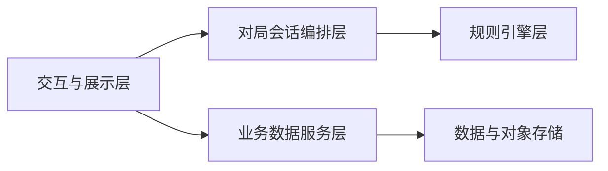
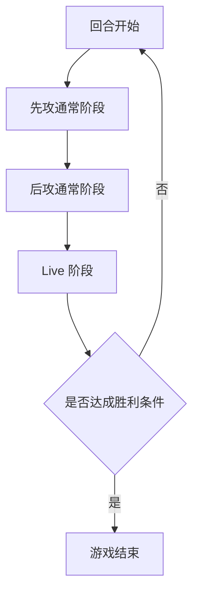

# Loveca 项目总体需求文档

> 文档类型：需求文档  
> 适用范围：Loveca 项目整体产品与规则需求（不包含具体实现细节）
> 当前状态：总体产品与规则需求；具体领域契约由对应专题需求维护
> 更新时间：2026-10-23

本文回答产品要服务谁、满足哪些核心规则和跨模块约束。能力覆盖见[项目现状](current-state.md)，当前架构见[系统设计](system-design.md)，任务排序见[项目待办](../PROJECT_PROGRESS_TODO.md)。完整职责分工见[文档地图](README.md#总领文档的职责)。

---

## 1. 项目目标

Loveca 是 **Love Live! series official card game** 的数字化对战产品，目标是提供可在线上进行的双人卡牌对战体验，并支持卡组管理与卡牌数据维护。

### 1.1 胜负目标

- 任一玩家「成功 Live 放置区」达到 **3 张**时获胜
- 若双方在同一结算时点同时达到 3 张，判定为平局

---

## 2. 产品范围与角色

### 2.1 使用角色

- 普通玩家：进行本地或联机对局、管理卡组
- 赛季管理员：管理赛季排位、轮换主题牌桌及两个赛季入口显示，不获得平台维护、卡牌、构筑规则或用户权限管理能力
- 平台管理员：维护卡牌数据与卡图资源，管理 PT 限制表、平台维护/公告、回放保留、用户角色、排位赛季与轮换主题牌桌，观测线上房间、对局和异常结算状态

### 2.2 产品范围

- 对局系统（阶段推进、拖拽操作、规则校验）
- 新手教程（访客可用、权威规则流程、共享牌桌引导）
- 联机系统（房间创建与加入、玩家准备、对局同步、断线恢复）
- 管理员 AI 对战调试（精选构筑、共享真人牌桌、可见信息决策与只读决定观察）
- 赛季排位系统（固定时段候场、积分结算、排行榜和赛季运营）
- 轮换主题牌桌（固定时段活动、服务端预组、组合分配和非计分赛季战绩）
- 卡组系统（构筑校验、导入导出、对局前选组）
- 账号系统（注册登录、会话恢复、离线模式）
- 卡牌数据系统（查询、编辑、发布状态管理、图片管理）
- 管理后台（卡牌数据维护、平台维护与公告配置、回放保留与赛季原始分析数据导出、活跃房间监控）

---

## 3. 业务架构需求（逻辑分层）

系统需满足以下逻辑分层，保证规则与界面解耦：

### 3.1 分层职责

- 交互与展示层：负责桌面布局、拖拽交互、阶段提示、结果展示
- 对局会话编排层：负责回合推进、动作分发、操作历史与撤销
- 规则引擎层：负责合法性校验、自动规则处理、胜负判定
- 业务数据服务层：负责用户、卡组、卡牌、图片等业务数据接口
- 数据与对象存储：持久化结构化数据与静态资源

---

## 4. 核心规则需求

### 4.1 卡牌体系

- 卡牌类型包含：成员卡、Live 卡、能量卡
- 每张卡牌需有唯一卡牌编号（用于构筑同名判断）
- 每张对局中的实体卡需有唯一实例标识（用于区域流转追踪）

### 4.2 Heart 与应援

- Heart 包含粉、红、黄、绿、蓝、紫、橙七种指定颜色，以及无色/Gray 与 Rainbow/All
- 无色/Gray Heart 只计入判定所需 Heart 总数，不能补足指定颜色缺口
- Rainbow/All Heart 在判定时可用于补足任意指定颜色缺口
- 演出判定需综合成员提供的 Heart 与应援提供的额外 Heart
- 应援相关额外得分需纳入 Live 分数结算

### 4.3 区域体系

每位玩家需具备以下核心区域：

- 手牌、主卡组、能量卡组
- 成员区（左/中/右槽位）
- 能量放置区、Live 放置区、成功 Live 放置区
- 休息室、除外区
- 共享解决区

成员槽位应支持与其绑定能量的联动移动与清理规则。已登记卡牌效果可在舞台主成员下方堆叠成员卡（`memberBelow`），其联动移动与清理规则与能量卡类似；玩家手动命令不得创建堆叠，既有公开桌面拖出行为保留。

### 4.4 对局流程

#### 4.4.1 开局准备

- 双方洗混卡组
- 双方抽取初始手牌
- 双方放置初始能量
- 进入换牌阶段

#### 4.4.2 换牌阶段

- 双方依次可选择任意数量手牌；选中牌先暂时离开手牌，从原主卡组顶抽取相同数量，再将换掉的牌放回主卡组并洗牌

#### 4.4.3 回合结构

通常阶段至少包含：

- 活跃恢复
- 能量补充
- 抽卡
- 主要操作（出成员、接力、能力相关操作）

Live 阶段至少包含：

- 双方设置 Live
- 双方演出与判定
- 胜败结算与成功区处理
- 先攻更新（当且仅当结算结果满足更新条件时）

### 4.5 检查时机与自动规则处理

系统需支持检查时机循环，自动执行规则纠偏，包括但不限于：

- 牌库刷新处理
- 胜利条件检测
- 非法区域卡牌纠正
- 槽位异常状态清理

### 4.6 费用与构筑

- 成员登场需支付能量费用
- 接力需支持费用减免逻辑
- 主卡组与能量卡组需满足固定数量约束
- 主卡组同基础编号卡牌数量需受上限约束
- PT 限制按基础编号计算，不得以罕贵度后缀绕过；标准与排位等既有准入要求卡组总 PT 不超过当前生效表上限；自组真人娱乐对战取消总 PT 门槛，其他构筑限制照常，详见[标准与娱乐规则](online-mode/community-lobby-requirements.md#fr9-标准与娱乐模式)

---

## 5. 功能需求

本章维护各领域的产品目标与跨领域约束。具体流程、数值、界面细节及完整验收要求由链接的专题需求维护；实现路径、运行字段与迁移步骤由设计文档和 Runbook 承担。

### 5.1 对局交互

- 提供可理解的双方区域、阶段、行动权、关键步骤确认与结果展示。
- 支持拖拽及触屏可达的等价操作；手机核心流程不能只依赖 hover、长按或双击。
- 所有规则操作经过权威命令校验；前端操作可见性不能代替合法性、费用或权限检查。
- 新对局默认规则模式；自由模式为尚未自动化的规则提供受控人工处理，不能改变服务端权威或隐藏信息边界。正式联机开启自由模式需双方同意，观战与回放只读。
- 本地调试、对墙打、正式联机、观战、回放与教程复用共享游戏桌，并按各场景限制交互能力。
- 候场音乐与成功提示应尊重玩家偏好；曲库、音频或自动播放失败不能阻断匹配。
- 新手教程应让访客与登录玩家通过真实规则和共享牌桌完成基础对局，不泄漏私密场景，不写正式战绩。

边界见[对战模式说明](battle-mode-purpose-and-boundaries.md)；交互与验收见[移动端需求](ui-design/mobile-adaptation-requirements.md)及[教程需求](tutorial/requirements.md)。

### 5.2 用户与会话

- 支持注册、登录、登出、会话恢复和在线／离线边界；可按部署配置启用邮件验证与密码恢复。
- 玩家可维护账号资料与凭据；邮箱换绑需验证当前密码，并由新邮箱确认生效。敏感凭据更新后撤销可续期会话。
- 提供可公开访问的版权、权利通知与隐私说明，其内容应与实际数据范围和保留期限一致。
- 玩家桌面壁纸只影响当前观看者，不进入权威对局、对手投影、历史或回放。

壁纸范围与验收见[壁纸需求](player-wallpaper/requirements.md)，账号与会话实现见[系统设计](system-design.md#8-服务端与数据设计)。

### 5.3 卡组管理

- 支持卡组创建、编辑、删除、复制、分享和导入／导出，并提供构筑合法性反馈。
- 离线访客可在浏览器管理和选用本地卡组；本地保存不等于账号同步或服务端准入。
- 联机参与者使用经过服务端校验的锁定卡组，后续编辑不得改写已经冻结的对局快照。
- 保存及新开局按适用的当前构筑与 PT 规则校验，不信任客户端派生合法性；对局保留实际使用的构筑环境以便追溯。

具体行为与默认构筑见[卡组需求](deck-management/requirements.md)，数据边界见[卡组设计](deck-management/design.md)。

### 5.4 卡牌数据管理

- 支持卡牌查询、筛选、管理员维护、发布状态与卡图资源管理。
- 普通玩家构筑和正式准入使用发布数据；同步及管理写入不能隐式改变进行中对局的冻结资料。
- 同一基础编号的构筑与效果身份不应因印刷罕度不同而被错误分裂。

具体范围见[卡牌数据管理需求](card-data-management/requirements.md)与[同步需求](card-data-sync/requirements.md)。

### 5.5 联机房间与对局

- 标准／娱乐休闲玩家可公开找人或定向加入房间，共用锁组、双方确认、开局与赛后再战流程；排位与主题活动保留各自准入及赛后规则。
- 正式开局经双方确认、猜拳与胜者选择先后手；玩家按自身权限查看和操作，不接触对手私密信息。
- 断线、超时、认输、离房及无法恢复的结果必须明确且双方一致；页面返回不能替代对局或参与关系的处理。
- 观战只读取当前获授权的玩家视角与公共日志，不能执行命令；授权变更及房间代际变化不能沿用旧权限。
- 对局双方可发送有界文字及当前有效的快捷表情，观战者只读；局内通信不能代替规则操作或改变时限，也不进入历史回放。
- 玩家可在声明的保留期内查看历史与只读回放；清理后保留必要元信息，独立长期统计事实不随回放明细删除。

休闲产品契约见[大厅需求](online-mode/community-lobby-requirements.md)，状态与恢复见[房间生命周期](online-mode/room-exit-and-recovery.md)，通信见[快捷表情专题](online-mode/match-emote-requirements-design.md)，历史范围见[回放需求](match-replay/requirements.md)。

### 5.6 赛季排位

- 玩家在独立赛季查看开放安排、积分、参榜进度、战绩与排行榜，并以合法卡组参加统一候场。
- 赛季冻结竞技环境与评分身份；评分、迟到结算和带原因更正必须幂等、可追溯并能确定性重建。
- 操作超时与断线裁定依据权威责任方和本局冻结时限，轮询、聊天及旁观不能延长玩家操作时间。
- 赛季生命周期与候场、进行中对局、终局结算之间必须一致，不能通过修改赛季状态丢弃尚未处理的结果。
- 卡组分类和环境展示使用可追溯的统计口径，公开样本量、覆盖与未知状态，不泄漏玩家私有构筑。
- 管理员可查询赛季、参赛者、运行健康与异常结算；不得直接覆写评分或用当前配置替代历史算法身份。

数据、结算和生命周期见[排位核心设计](matchmaking-and-ladder/RANKED_R2_DATA_AND_SETTLEMENT_DESIGN.md)，环境统计口径见[卡组分类专题](matchmaking-and-ladder/RANKED_DECK_CLASSIFIER.md)，当前能力与验收见[排位实施边界](matchmaking-and-ladder/RANKED_INITIAL_IMPLEMENTATION.md)。

### 5.7 轮换主题牌桌

- 提供固定时段的预组活动，玩家可了解候选构筑、玩法与卡表；活动战绩不引入积分或排行榜。
- 预组候选与配组由服务端决定；支持配置数量的候选选择，刷新不能重抽，最终选择与开局卡组保持一致。
- 发布后冻结规则、预组与组合身份；历史分配必须可追溯，后续编辑或停用不能改写旧事实。
- 开局前无过错中断应按活动规则恢复参与顺序，正式开局后的对局与超时规则保持统一。
- 活动开放前完成专题规定的真实组合试打、恢复、运营指标与双端验收。

产品规则与验收口径见[主题牌桌需求与设计](matchmaking-and-ladder/ROTATING_THEME_TABLE_DESIGN.md)。玩家入口称为“主题牌桌”，与自组娱乐规则房间区分。

### 5.8 运营角色与平台运维

- 运营权限由服务端显式校验。赛季管理员只获得赛季和活动运营能力；平台维护、卡牌、构筑规则、私密配置及用户授权保持独立边界。
- 特权操作按账号当前角色复核；降权后旧授权失效，最后一个平台管理员不能被降级。真实账号委派遵守[角色上线条件](admin-center/season-admin-role.md)。
- 管理员可维护 PT 表、活动公告、封面、徽章和公共候场曲库；规则发布、资源写入及破坏性操作遵守各专题的并发、追溯与失败边界。
- 玩家大厅的赛季入口显示只影响导航发现，不代替活动生命周期、开放时段或准入状态；练习准备只提供对墙打与双人调试。
- 平台维护支持限制新对局并让存量收尾；API 停止后仍可显示维护状态，维护与普通故障需区分，恢复开放前校验必要依赖就绪。
- 数据维护需保护长期事实与隐藏信息；清理回放必须明确确认，赛季分析只导出批准范围内的匿名事实，不包含完整对局私密负载。
- 实时运营观测只提供状态或授权玩家视角，不获得上帝视角，也不得直接覆写权威对局结果。
- 管理员 AI 对战与卡效提取共用受控的私密上游配置；AI 对战仅使用合法可见信息和正常规则命令，决定观察不改变对局、不计入赛季成绩。

运维契约见[维护与公告](platform-operations/site-status-and-announcements.md)，活动资源见[封面专题](matchmaking-and-ladder/SEASON_ACTIVITY_COVER_REQUIREMENTS_AND_DESIGN.md)，AI 运行边界见[运行与观测](ai-battle/runtime-and-observation.md)。

---

## 6. 非功能需求

- 规则一致性：对局状态应可被规则层持续校正
- 联机一致性：联机对局应以服务端权威状态为准，并按玩家视角脱敏展示
- 可维护性：规则层、会话层、展示层职责清晰
- 可扩展性：可新增卡牌效果、子阶段和新模式
- 可部署性：支持自托管部署与环境配置
- 可测试性：核心规则、流程与关键交互需具备自动化测试覆盖
- 任务连续性：应用发现新版本时不得自动刷新或清除业务缓存；进行中的对局和未保存操作必须继续可用，只有玩家在安全页面明确确认后才能切换版本
- 返回体验：页面重新挂载时应优先复用当前登录用户已有的服务端数据快照；后台刷新不得清空仍可使用的卡组列表或把页面重新降级为冷加载

---

## 7. 已规划但未纳入当前交付范围

- 公开段位、高价值排位奖励、按积分或其他偏好的匹配，以及多排位池
- 完整确定性重演、公开分享回放与自动复盘分析
- 完整动画与音效体系
- 更高强度压测与专项性能治理
