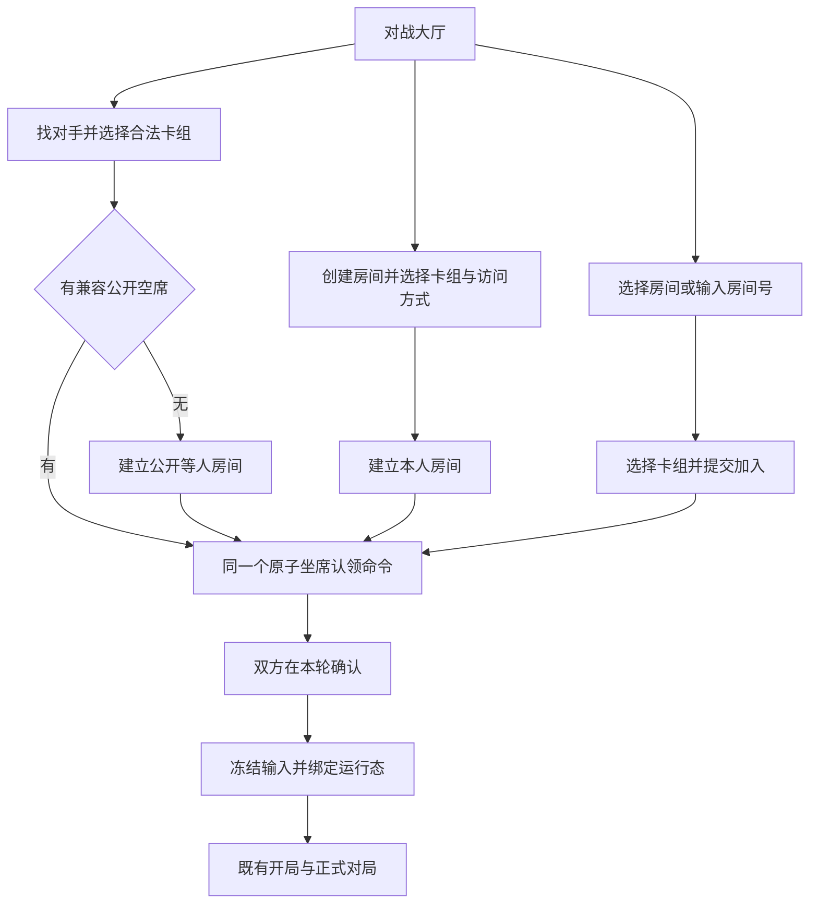
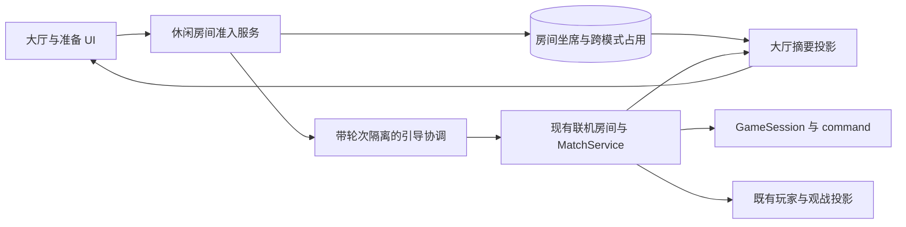

# 社区对战大厅业务与界面设计

> 文档类型：设计文档
> 适用范围：统一休闲房间模型、坐席认领、列表投影、导航和大厅 UI
> 当前状态：本地实现；生产切换尚未执行，原型仍使用本地示例数据
> 日期：2026-10-16
> 上游：[重构需求](community-lobby-requirements.md)、[调研与来源](community-lobby-research.md)

## 1. 设计决策

以可识别、可分享的休闲房间作为玩家的连续交互对象。公开等人、选定对手、双方确认、开局、赛后与再战围绕同一房间组织。自动找人和手动加入共用一个坐席认领操作。

采用持久的休闲房间准备模型承接现有两条不同的准备路径，双方确认后再绑定既有正式联机运行态。这样可以复用目前的数据库占用、租约与引导思路，同时让等待中的房间从创建起就具有稳定标识。

| 决策       | 选择                                         | 原因                                   |
| ---------- | -------------------------------------------- | -------------------------------------- |
| 统一程度   | UI、等人供给、加入和确认语义一起统一         | 只合入口仍会出现有人排队、有人空房互等 |
| 自动找人   | 加入最早兼容公开房间；没有候选则建立公开房间 | 保留简单操作，和直接选房共享供给       |
| 准备流程   | 创建、找人、加入时锁组；配对后双方确认       | 同一套确认语义，避免隐式替对手同意     |
| 可发现范围 | 登录成员可看公开房间；凭链接房间不列出       | 服务社区发现，同时保留定向约战         |
| 对战运行态 | 沿用规则引擎、权威命令、投影与正式桌面       | 重构集中在对局外层业务                 |
| 列表外观   | 紧凑行列表，移动端纵向重排                   | 主要任务是识别人、状态及行动           |

这里的“公开”是对本站登录成员可发现；不是将账号活动发布给整个互联网，也没有新增一个尚不存在的社区成员审批系统。

## 2. 当前边界与改造对象

重构前的业务基线及代码证据集中在[调研第 2 节](community-lobby-research.md#2-重构前基线与约束)。当前实现的职责变化如下：

| 重构前职责                   | 当前职责                                 |
| ---------------------------- | ---------------------------------------- |
| 休闲候场票据等待另一张票据   | 公开等人房间等待另一名玩家               |
| 手建房准备与匹配确认分别实现 | 休闲房间统一锁组、占位与确认             |
| 配对成功之后才生成自动房间号 | 找人开始时即有稳定房间号                 |
| 普通玩家按房间号查找         | 大厅公开摘要，加定向房间号查询           |
| 管理房间汇总                 | 继续独立管理用途，不作为玩家列表的数据源 |
| 标签页房间号作为恢复线索     | 权威占用发现当前房间，标签页线索辅助导航 |

新的休闲模型不替换排位和主题票据。`public-table-service.ts` 现仅承载排位与主题队列；休闲接入由 `casual-table-service.ts` 承担，保留活动的事务、分配事实、无过错恢复和结算链路。

## 3. 业务模型

### 3.1 休闲房间与一轮对局

`CasualTable` 是持续存在的休闲房间，`roundId` 是本次准备与开局尝试。准备成员、冻结快照和确认归休闲服务管理，卡牌状态与终局归 GameSession／MatchService 管理。

完整的准备、运行房间、对局、占用和成员在场状态机统一维护于[房间状态机与生命周期](room-exit-and-recovery.md)。本文只描述大厅与准入架构，不再维护第二份退出、再战或超时规则。

### 3.2 访问方式与资格

房间只增加一个可发现性字段 `discoverability`：`PUBLIC` 或 `UNLISTED`。是否能加入由房间状态、剩余席位、有效心跳、规则环境、卡组合法性及玩家占用共同推导，不另存一组易失真的 `isJoinable`、`isPlaying`、`isFull` 布尔量。

`PUBLIC + WAITING + 有效输入` 构成公开等人供给。创建与找人使用不同命令，不额外持久化创建来源；坐席的 `continue_public` 记录无过错恢复所需的公开等待意图。主动建公开房会创建本人的房间；只有「找对手」执行自动选择。

`UNLISTED` 通过有效房间号或链接访问。它不是带受邀账号名单的房间，也不额外建立密码系统。首版访问方式创建后固定，在当前房间内不提供改公开范围的开关。

每名坐席记录其是否愿意在无过错中断后继续公开等待。直接加入指定房间不自动获得这一意图，不能在对手退出后被重新公开。

### 3.3 三个进入流程

没有卡组时打开选组说明与管理入口；大厅列表保持可读。选组弹层不会提前占座。点击「加入房间」后才提交认领，服务端允许房间在此期间变满并返回明确结果。

### 3.4 等待与在场

本人跨页面协调器负责准备与赛后保活；公开列表与观战读取不为参赛者续命。进行中继续使用桌面在场与模式自身的超时规则。所有期限、无过错恢复与进程重启边界见[生命周期第 3、7 节](room-exit-and-recovery.md#7-在场恢复与超时清理)。

## 4. 持久数据与权威归属

### 4.1 最小数据结构

两张休闲运行表承担准备状态，不增加通用事件审计表或全站在线人员表：

| 实体                 | 必需字段组                                     | 实际读取者                         |
| -------------------- | ---------------------------------------------- | ---------------------------------- |
| `casual_tables`      | 身份、房间号、可发现性、备注、规则环境         | 大厅、邀请链接、加入资格           |
| 同上                 | 当前轮次、准备状态、revision、等待起点和确认期限 | 并发命令、稳定排序、等待与确认时长 |
| 同上                 | 引导租约、尝试次数、运行态绑定身份             | 引导协调、恢复与补偿               |
| 同上                 | 创建幂等键、创建和关闭时间                     | 重试、有效房间号唯一性、运行表清理 |
| `casual_table_seats` | tableId、席位、用户                            | 坐席与当前状态发现；轮次由房间读取 |
| 同上                 | 锁定卡组快照及版本、本轮确认                   | 正式对局冻结输入与合法性核验       |
| 同上                 | 心跳、持续等待起点、继续公开等待意图           | 有效供给、无过错恢复               |
| 同上                 | 本人观战开关                                  | 逐人授权与本轮运行态冻结           |

约束为每房间最多两席、每席唯一、每个玩家只有一份真人占用、有效房间号唯一。两人对局人数固定为 2，不新增可配置人数列。准备状态只有本表权威；进行中状态从运行态读取，不在表中维护同步的游戏阶段副本。

卡组快照复用现有 transport serde 与合法性事实，不用普通 JSON 序列化丢失运行时类型。源卡组 ID 仅作所属及来源引用，开局使用冻结快照。

本轮记录保存在运行表，已完成对局的历史事实仍归现有 match records；不要为了大厅新建另一份历史战绩库。准备快照在不再需要恢复后清理，不能永久作为卡组副本保留。

### 4.2 占用整合

扩展 `gameplay_participations`，使它能够引用休闲房间。在准备阶段使用明确的 `CASUAL_TABLE` 占用，进入正式 match 时转换为已有正式对局占用并保留休闲房间关联。

用户唯一性约束继续覆盖排位、主题和旧正式联机链路。事务必须检查引用字段与 kind 一致；不能在客户端先取消一种占用、再建立另一种占用来模拟原子切换。

`GET me` 从这份占用定位当前休闲房间或活动状态。`sessionStorage` 的旧房间号不能决定实际占用归属。准备与对局的所有休闲成员变更都通过统一入口协调，不能继续让旧 `joinRoom` 绕过持久坐席直接加人。

### 4.3 与内存运行态的边界

数据库事务提交与进程内建房不具备一个共同原子提交。明确使用 `BOOTSTRAPPING`、幂等绑定、租约和补偿处理这个边界，不能把两步都成功视为同一个事务天然保证。

本轮观战开关先提交持久坐席，再在准入锁内重读已提交值并同步运行态权限；延迟请求不能覆盖后续已提交的选择。提交失败不应用未提交的授权，提交响应丢失或同步中断时，由现有清理／本轮恢复流程按持久坐席重新同步；同步不续玩家在场时间，也不在锁内加载配置。

准备记录持久化不代表完整 match 可跨进程恢复；运行态缺失的关闭与占用释放见[生命周期](room-exit-and-recovery.md#7-在场恢复与超时清理)。

## 5. 并发与失败规则

### 5.1 原子找人或建房

卡组解析、静态资源和非事务外部读取在进入短事务前完成；事务内按冻结版本核验，不能把网络或卡图加载放进锁持有期。

首版针对每个休闲规则环境采用短期事务级准入锁，统一序列化“选候选／认领／无候选建房”。锁顺序固定为规则环境、房间、按用户 ID 排序的占用。这样两人同时无候选时，后提交者可以看到前者新建的房间，不留下两个一直互等的单人房。该选择适合本次熟人社区范围，扩展吞吐前先测量实际锁等待。

直接加入也经过相同的准入约束；同一空席只有一个认领结果。对照服务端 `roundId + revision` 校验旧页，绝不凭前端显示的空位数决定成功。

重复提交使用活跃房间的创建幂等键和已有占用返回同一结果。加入、确认和取消以本轮身份识别重复请求；若状态已前进，返回当前状态，若目标已经换轮则返回状态冲突，不将旧操作转发到新轮。

创建、找人和加入先识别已提交请求的重试，再检查新准入限制；限制期间仍允许恢复已有结果，新的入场请求由服务拒绝。生命周期配置在取得准入连接与锁之前加载，不能持有准入连接时再从同一连接池申请配置查询连接。

公开列表使用一次不加准入锁或行锁的聚合查询，批量读取房间、公开成员和本人归属；轮询不执行全局清理，也不逐房读取卡组快照。摘要按当前心跳／确认期限隐藏已失效的供给，状态回收仍由清理协调器及写命令完成；实际加入与观战继续核验最新权威状态。

### 5.2 取消与切换

「取消当前等待并加入另一个房间」在同一准入事务中执行：先验证目标确有可认领空席，再转移准备占用。目标无效则保留原等待。进入 `RESERVED` 以后不支持无提示的跨房切换，先明确取消本次配对。

确认与取消竞争时，由锁定的权威状态决定一个结果。进入 `BOOTSTRAPPING` 后不能把取消当成普通删席；完成或补偿该轮引导，再呈现确定结果。

### 5.3 无过错恢复

取消、未确认、失联与卡组失效的恢复规则集中在[生命周期恢复矩阵](room-exit-and-recovery.md#31-取消未确认与失联后的另一方)。准入事务根据持久坐席的公开意图和原等待起点处理，不能仅凭按钮来源或“已经确认”推断公开授权。

### 5.4 引导与轮次隔离

运行态绑定使用 `tableId + roundId` 幂等键，房间号在首次等待时已分配，不在配对成功后另换一个。引导者提交结果时验证租约、轮次及 revision；旧租约即使迟到也不能覆盖新轮次。

同进程所有该轮运行态创建和失效均检查轮次围栏。多进程部署只有在能将相同房间命令稳定路由到实际运行态所有者、并拒绝旧所有者写入时才可启用；数据库租约本身不提供游戏运行态的跨进程围栏。首版沿用当前房间执行拓扑，不宣称完成多节点容灾。

卡组冻结和准备完成后，复用现有猜拳、先后手、权威命令与投影。正式对局持久来源使用现有非计分来源，不为 UI 新增“自动房”“手动房”历史来源枚举：本轮由自动配对完成的使用 `PUBLIC_TABLE`，由定向加入完成的使用 `ONLINE_ROOM`；来源在开局时冻结，不因房间曾由哪个按钮创建而变化。两者赛后均使用本设计的休闲房间规则，不能再据历史来源决定新的准备归属。

## 6. 读取契约与前端职责

### 6.1 读取与操作边界

`/api/casual-tables` 的读取与操作职责如下：

| 契约                   | 返回或执行                                     | 访问范围                   |
| ---------------------- | ---------------------------------------------- | -------------------------- |
| 大厅列表               | 公开摘要、公开分类计数、快照时间和分页游标     | 登录；无私房计数           |
| 本人当前状态           | 所属房间、轮次、卡组摘要、确认期限及下一步     | 本人                       |
| 定向房间预览           | 有效房间号的可加入摘要；不直接返回私有准备信息 | 登录；与加入权限一致       |
| 找对手                 | 原子选择或建立公开房                           | 登录、合法输入、无冲突占用 |
| 创建房间               | 创建 PUBLIC 或 UNLISTED                        | 同上                       |
| 加入／切换／确认／取消 | 按当前轮次修改准备权威状态                     | 对应玩家与房间资格         |
| 观战入场               | 再次检查当前开放视角，再创建授权会话           | 沿用现有观战鉴权           |

玩家列表投影不能调用管理员房间接口，也不能先把 `OnlineRoomView` 或完整服务状态发到前端再隐藏。摘要通过字段允许列表返回房间与轮次身份、成员昵称、展示状态、备注、状态起点、开放视角及操作能力；人数由成员列表推导，失败结果归本人状态。

摘要不包含邮箱、账号内部权限、源卡组 ID、卡组名、快照、手牌、猜拳暗选或观战 token。公开排位／活动摘要只接入显式允许大厅展示的活动；未声明公开范围的既有活动不自动扩大曝光。

列表中的 `canJoin` 与 `spectatorViews` 由服务端投影派生，便于一致提示，但不替代提交时再校验。房间号以外的标识包含轮次，避免旧列表操作进入复用同码的新房间。

### 6.2 列表、计数和时效

首版每批最多 50 条，使用明确的继续加载和游标；计数来自同一可见范围和同一读取快照。游标固定查询条件与创建时间上界，并记录末行排序键；客户端按 tableId 去重。活跃列表在读取期间变化时，不承诺数据库级冻结整个翻页会话。

默认排序为等待、准备、进行中、赛后；等待组按有效等待起点升序，其他组按稳定开始时间及身份排序。赛后房间仅短时保留其真实状态，不计入正在对战；本人房间由独立状态区域展示。私房不出现在搜索、计数和“新房间”提示中。

页面可见时每次读取完成后等待 5 秒再刷新，进入页面与重新获得可见性时立即刷新；隐藏时暂停列表轮询，本人候场保活独立运行。错误重试退避至最多 30 秒。此配置仍需生产负载与可用性验收。

已有内容刷新时维持原行位置和控件焦点。状态和已失效按钮立即更新，新增房间通过“有新房间，更新列表”提示插入；新排序由用户确认、切换筛选或重新进入页面时应用。已离开当前列表的行暂留并标记失效，显式更新列表时再移除。

读取失败保留已有数据并显示最后更新时间；超过两个刷新周期没有新成功响应时标记“状态可能已变化”。加入和观战仍以服务端最新检查为准。没有任何成功快照时显示加载失败，而不是计数 0。

### 6.3 状态所有权

- 列表和普通摘要属于一份服务端读取缓存；不镜像到多个 store。
- 本人准备、心跳、倒计时和一次性进入协调属于绑定用户的实时状态。
- 搜索、筛选、选组弹层和备注草稿属于页面／路由状态。
- 对局卡牌状态继续属于既有 battle store 与权威快照。

按[前端外层重构设计](../frontend-app-architecture/requirements-and-design.md)的边界接入当前实际具备的缓存与导航能力，不以本次大厅为理由强制完成全站 Router 或 Query 迁移。本人状态只保留一个协调器；进入新轮次的自动导航只消费一次，返回大厅不再次抢走页面。

## 7. UI 方案

### 7.1 页面原型与依据

选择现有[产品视觉系统](../ui-design/product-visual-system.md)中的列表与工作台语言。交互结构的依据如下，外部来源的具体含义与适用限制见[调研](community-lobby-research.md#4-研究与设计系统依据)：

| 界面部分           | 采用的模式                                 | 依据                                     |
| ------------------ | ------------------------------------------ | ---------------------------------------- |
| 找人操作及可见房间 | 自动操作与手动选择共享目标                 | BGA 自动／高级大厅互通案例               |
| 房间主体           | 昵称、状态、人数和明确行操作               | Cockatrice 对局列表；Social Translucence |
| 我的状态           | 固定位置显示当前任务和唯一下一步           | NN/g 状态反馈                            |
| 建房和选组         | 在操作中展开                               | NN/g 渐进展开                            |
| 桌面对齐行         | 同类对象稳定列与筛选工具栏                 | Carbon 数据表                            |
| 手机重排           | 保留昵称、状态与行操作，次要信息换行       | Carbon 信息组织；WCAG Reflow             |
| 弹层键盘行为       | 初始焦点、Tab 范围、Escape、关闭后归还焦点 | W3C APG Dialog 模式                      |

本方案组合的是已有模式；具体的列优先级、默认筛选、等待排序和断点是项目设计假设，不称为外部研究已经证明的最佳答案。

### 7.2 桌面布局

页面使用普通产品顶栏与内容宽度约 1120px 的单列主区域，不新增常驻社交侧栏。自上而下为：

1. 页面标题「对战大厅」，右侧为主按钮「找对手」与次级「创建房间」「输入房间号」。
2. 仅有任务时显示「我的房间」，提供候场、确认、返回房间或赛后操作；空闲时不放状态卡片和系统实现说明。
3. 公开房间区域。标题旁用弱化文字显示真实数量，下方为「所有房间／等待对手／正在对战／可观战」轻量页签，以及昵称／房间号搜索和刷新。
4. 以统一列对齐的房间行，不在每个房间里放一幅大图或多个嵌套面板。

| 行区域     | 内容与优先级                                               |
| ---------- | ---------------------------------------------------------- |
| 参与者     | 房主昵称；有人加入后显示双方昵称；备注为可选第二行         |
| 状态       | 等待加入、双方准备、开局中、对战中、已结束；文字配合语义色 |
| 人数／模式 | 1/2 或 2/2；仅需区分的模式标识                             |
| 时间与观战 | 等待时长或对局开始后时长；开放视角与否                     |
| 操作       | 加入、观战、返回；不适用时给出状态原因                     |

房间号为次要的等宽信息，昵称为主要识别信息。准备中、开局中和关闭观战的行仍有可理解的状态，不用一个没有理由的灰按钮占位。

### 7.3 移动端布局

低于 768px 时以纵向列表显示，每行第一层为昵称与状态，第二层为人数／模式／时间，第三层按需要放备注与操作。无需横向拖动桌面表格。

顶部次操作可以换行；筛选用自然换行的按钮组，不能依赖不可见的横滑标签。我的当前状态保留在列表上方，不默认吸顶占满首屏。跨页面候场使用既有全局位置并处理安全区；在大厅本页内不再重复显示第二个相同浮条。

找对手、创建、加入和输入房间号均可在单个可滚动弹层中完成；手机可使用底部弹层，键盘弹出后主操作仍可达。弹层关闭保留未提交的卡组偏好，不提交房间写操作。状态确认不能依赖桌面 hover。

### 7.4 我的状态与操作

| 本人状态   | 主内容                       | 主要操作                   | 次级操作             |
| ---------- | ---------------------------- | -------------------------- | -------------------- |
| 空闲       | 找人及建房入口，按需打开选组 | 找对手                     | 创建、房间号         |
| 公开等人   | 已等待时间、本人卡组、房间号 | 持续等待反馈               | 换组、分享、取消等待 |
| 凭链接等人 | 房间号、不会公开列出的提示   | 持续等待反馈               | 换组、复制邀请、取消 |
| 配对待确认 | 对手昵称、本人卡组、剩余时间 | 确认开局                   | 取消配对             |
| 自己已确认 | 等待对手确认                 | 保持等待反馈               | 取消配对             |
| 引导中     | 正在准备开局                 | 明确加载状态               | 服务端按租约有限重试 |
| 已有运行态 | 对手与当前状态               | 返回房间                   | 查看房间状态         |
| 赛后       | 本局结果、双方是否仍在       | 再来一局／处理已有请求     | 离开房间             |
| 无法恢复   | 关闭原因与席位释放结果       | 重新找人／创建房间         | 留在大厅             |

每次只有当前任务的主操作使用实心强调；列表中的加入与观战使用次级按钮。已经占用其他房间时，列表点击进入明确切换流程，不让所有列表行为静默失败。

### 7.5 表单与局部流程

**找对手**：弹层复用紧凑 `DeckSelector`，默认选中最近合法卡组；开始前显示“会加入或创建公开等人房间”。无合法卡组时引导构筑，并保留浏览。

**创建房间**：同一弹层依次为卡组、访问方式、可选备注、本人观战设置、创建。公开方式说明“出现在大厅，接受加入和自动找人”；凭链接方式说明“不出现在大厅，知道链接或房间号的玩家可加入”。无需用户输入房间号。

**加入房间**：先展示房主与已知状态，选择卡组后提交。等待提交时禁用重复提交，结果为确认面板或原位置的房间已满提示。只有点击本次提交才消耗坐席。

**观战**：只有一个开放视角时可直接进入；有两个时选择昵称对应的视角。入场前再次授权。没有开放视角时显示“未开放观战”；不显示灰色的对手私有信息预览。

**输入房间号**：输入后分别呈现可加入、已满、可观战、本人房间或无效房间。不能将“查找”本身当成加入或占座。

### 7.6 空态与异常

| 情况                   | 结果                                               |
| ---------------------- | -------------------------------------------------- |
| 成功读取且没有公开房间 | “当前没有公开房间”，保留找对手和创建               |
| 筛选无结果             | “没有符合条件的房间”，提供清除筛选                 |
| 首次读取失败           | “房间列表加载失败”，提供重试；不显示 0 人／0 房间  |
| 有旧数据且刷新失败     | 原列表保留，显示更新时间和局部重试                 |
| 认领时已满             | 在房间附近说明已被加入，刷新该行；本人仍可继续找人 |
| 暂停新对局             | 显示现有站点限制的真实原因；已有对局入口仍可恢复   |
| 本人已有排位／活动占用 | 显示对应任务与返回入口                             |
| 等待玩家失联           | 立即撤下可加入能力，不能继续将其当可配对象         |

### 7.7 视觉与无障碍

延续现有 Stage Ink、Stage Plum、Paper、Card White、Coral、Ready Aqua token。页面用系统中文无衬线字体，400／600 字重；房间号才使用等宽字体。10px 面板与 8px 控件圆角、44px 操作高度沿用项目规范，不引入新的主题或外部字体。

强调色文字与背景需检查实际对比度，不能因品牌色已经存在就默认白字可读。状态有文字和图形辅助，不只靠红绿区分。使用真实按钮和表单；筛选若使用按钮组则用 `aria-pressed`，不要写成缺少方向键行为的伪 tab。

弹层按 [W3C APG Dialog 模式](https://www.w3.org/WAI/ARIA/apg/patterns/dialog-modal/)管理初始焦点、焦点范围、Escape 与关闭后返回焦点；内容较长时优先聚焦标题，并在单个滚动容器中保留可达的操作。倒计时不每秒向读屏播报，仅播报开始、临近期限和最终结果。后台列表变更用克制的状态消息，不抢走焦点。主要流程应验证等效 320px 重排和 200% 文本缩放。

### 7.8 可交互原型

[交互原型](../ui-design/prototypes/community-lobby.html)是独立 HTML 设计附件，仅使用页面内存中的示例房间与卡组，刷新重置，不访问账号和房间 API。用于查看设计取舍和静态任务演示，不作当前视觉基线，也不验证数据库事务、网络竞态、跨标签页恢复或真实授权。

当前业务以 `CasualLobbyPage` 和[生命周期文档](room-exit-and-recovery.md)为准；产品与交互验收见[需求文档](community-lobby-requirements.md#6-验收场景)。

## 8. 模块改造范围

以下为当前模块职责；本地实现与生产切换边界见第 9 节：

| 模块                                                                       | 当前职责                                                                       |
| -------------------------------------------------------------------------- | ------------------------------------------------------------------------------ |
| `src/server/services/public-table-service.ts`                              | 仅保留排位／主题队列及其事务，休闲票据读写与后台配对已退役                     |
| `src/server/services/online-room-service.ts`                               | 休闲准备交给统一服务；支持按已分配房间与轮次幂等绑定；保留正式开局和运行态边界 |
| `src/server/services/gameplay-participation-service.ts`                    | 扩展休闲房间引用及原子转换，所有模式共享用户唯一占用                           |
| `src/server/db/schema.ts` 与 `drizzle/`                                    | 新增必要运行表与约束；显式处理旧休闲运行数据                                   |
| 新休闲准入与摘要模块                                                       | 单一空席认领、准备权威状态、读投影和有限恢复                                   |
| `client/src/components/pages/HomePage.tsx`、准备页、`App.tsx`              | 合并入口和返回路径；接入既有导航边界                                           |
| `OnlineRoomPage.tsx`                                                       | 拆分大厅／准备与沉浸式运行视图，复用既有 `GameBoard`                           |
| `CasualLobbyPage.tsx`、`CasualTableGlobalLayer.tsx`、`casualTableStore.ts` | 大厅页面、跨页面本人协调与串行状态桥接；旧休闲页面和协调器已移除               |
| `CasualLobbyPage.tsx` 与 `onlineClient.ts`                                | 大厅触发观战和房间号查找，保留 token 会话边界；旧独立观战查房页已移除         |

“房间联机”和“公共牌桌”的独立新导航入口已移除。既有 `/online/spectate/:token` 观战链接继续使用原有授权机制。

## 9. 实现与部署边界

大厅、统一休闲准备、逐人观战与赛后选组已接入本地代码，旧休闲票据和普通房间创建／加入写接口返回 410；排位与主题仍使用独立活动队列。运行接口为 `/api/casual-tables`，公开 DTO 位于 `src/online/casual-table-types.ts`。

旧页面参数与无 token 的 `/online/spectate` 引导到新大厅，已有 token 观战路径保留。旧手建房没有同意公开的事实，不原地转为公开房，也不新增新旧准备模型的运行时双读。

生产限制准入、排空、停写、备份、迁移预演、校验与回退只维护于[迁移说明](../../drizzle/migration-notes/community-lobby.md)，不在本设计重复发布步骤。本地测试不代表生产切换或玩家形成性评审完成。

## 10. 验证与观测设计

验证围绕[需求验收场景](community-lobby-requirements.md#6-验收场景)，不以按钮文案截图替代业务结果。

- 事务与服务测试：同时找人、争空席、重复请求、确认取消竞争、跨模式唯一性、无过错顺序和私房隔离。
- 引导故障测试：提交前后失败、租约过期、旧轮次迟到、有限重试耗尽、运行态丢失与占用清理。
- 投影和权限测试：真实终局分类、仅公开计数、字段允许列表、逐人观战权限及账号切换。
- 两个独立登录浏览器的 E2E：自动与手建互通、定向加入、再战、返回和双标签页；补齐排位和娱乐活动回归。
- UI 验证：320／390／768／1440 宽度、深浅主题、200% 文本、键盘、读屏消息、列表后台更新与弹层焦点。

后续观测以明确提交参与操作的用户会话作为分母，区分认领冲突与系统失败；找人到开局时长从有效求战意图开始算。现有运行错误不包含卡组内容，不将尚未建立的完整业务指标写成已实现能力。

没有足够历史时长与活动基线前，不在产品中显示预计等待时间，不声称开局率提升百分比。先做形成性测试，再按活跃时段、流量与供给变化解释上线指标。
