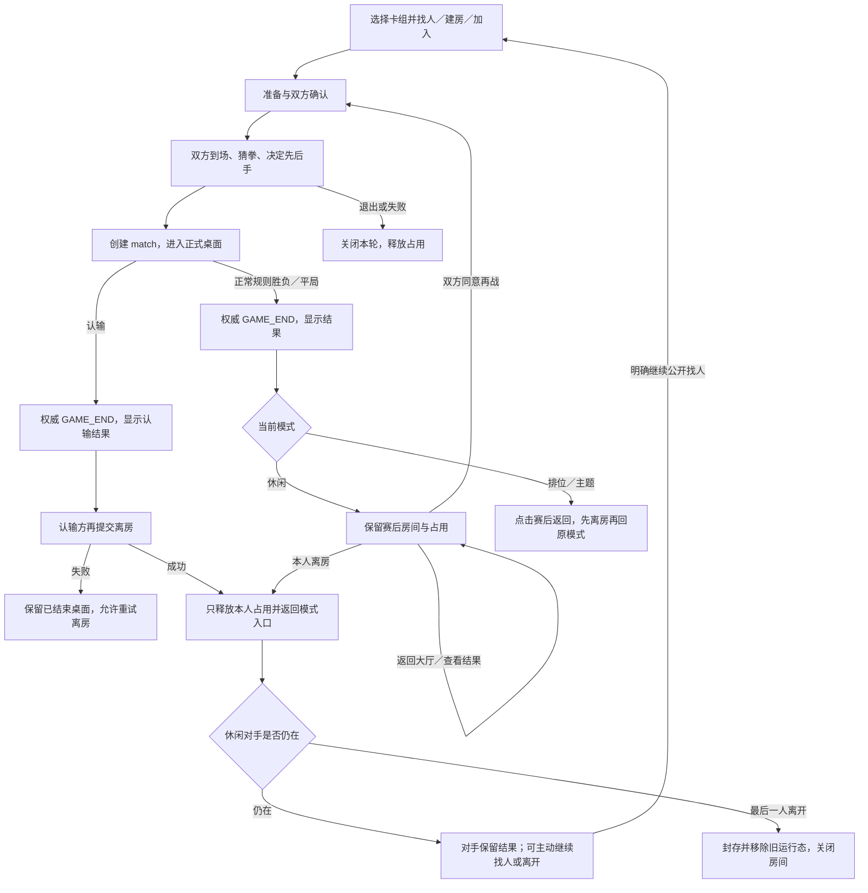
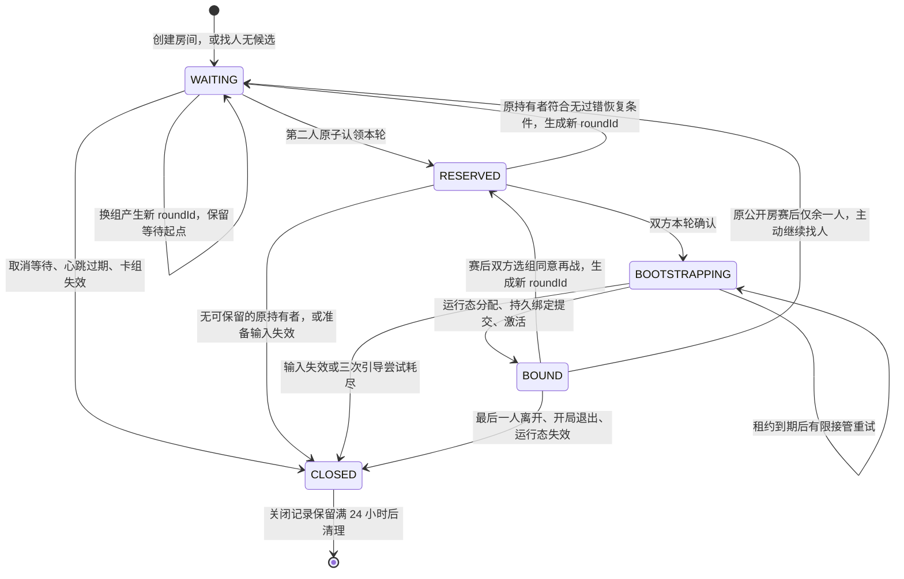
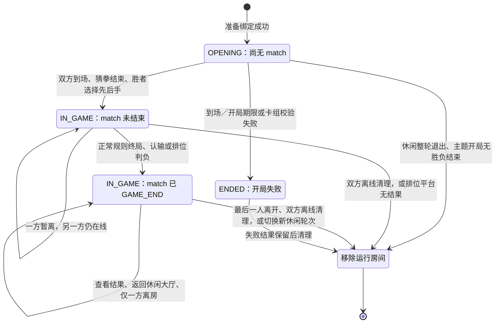
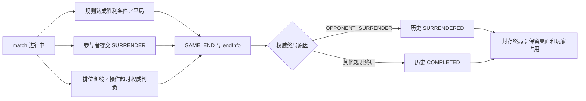
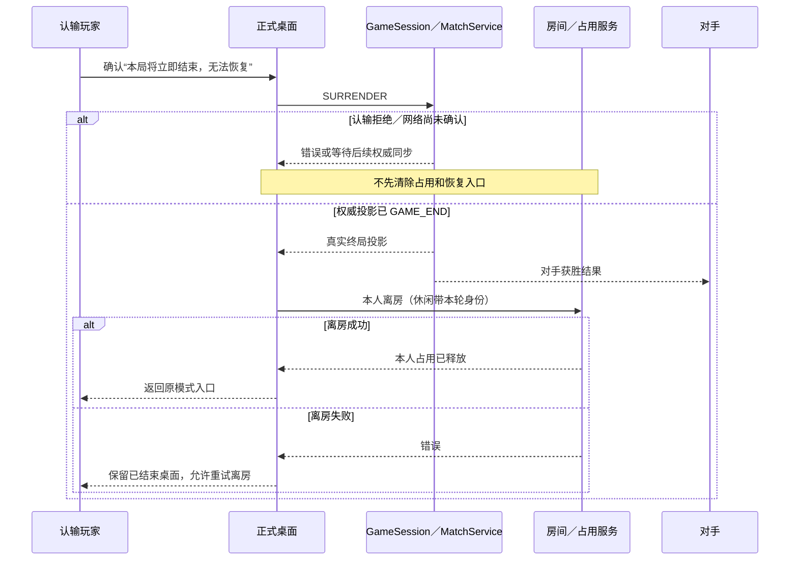
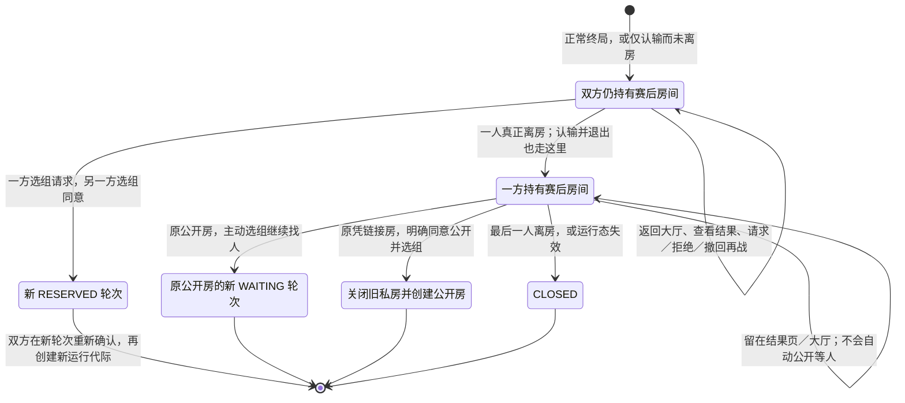
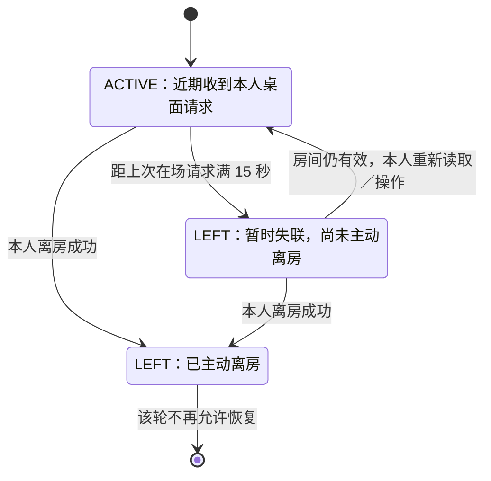

# 对战房间状态机与生命周期

> 文档类型：设计文档
> 适用范围：休闲、赛季排位、主题娱乐的真人房间；准备、开局、对局终局、离房、恢复与清理
> 当前状态：以当前 checkout 的实现为准；生产切换与玩家评审另行验收

本文是房间生命周期与玩家退出语义的权威说明。大厅发现、选组、列表与准入架构见[社区对战大厅设计](community-lobby-design.md)，局内命令和隐藏信息见[联机准备文档](preparation.md)，历史保留见[回放设计](../match-replay/design.md)。

## 1. 先区分五件事

**离开桌面页面、离开房间、对局结束、房间关闭、历史封存分别发生。** 不能用其中一个状态推断其余状态。

| 对象 | 权威状态／身份 | 含义与生命周期 |
| --- | --- | --- |
| 当前页面 | 客户端页面与远程会话 | “返回大厅”切页面；关闭标签页只是停止该页请求，不等同于服务端离房 |
| 休闲房间准备记录 | `tableId / roundId / revision`；`WAITING / RESERVED / BOOTSTRAPPING / BOUND / CLOSED` | PostgreSQL 持有坐席、冻结卡组和准备状态；同一个公开房可经历多轮对局 |
| 联机运行房间 | `roomGeneration`；`OPENING / IN_GAME / ENDED` | 进程内到场、猜拳、参赛成员、观战与 match 绑定；当前玩家入口不走旧 `PREPARING / READY` 准备模型 |
| 权威对局与历史 | `matchId`；`GameSession` 阶段和 `endInfo`；历史 `status` | 对局到 `GAME_END` 后停止规则推进并封存结果；保留终局运行态供双方查看，不立即删除房间 |
| 玩家占用与在场 | `gameplay_participations`；成员 `presence / voluntarilyLeft` | 占用防止跨模式重复参赛；在场仅描述最近是否收到请求。暂时失联不等于主动释放占用 |

休闲进入运行态时，占用由 `CASUAL_TABLE → ONLINE_ROOM → ONLINE_MATCH` 转换，始终保留 `casual_table_id`。对局结束不会自动删除 `ONLINE_MATCH` 占用；离房或清理才释放。排位、主题通过原票据／预留服务进入同一运行房间层，不创建休闲准备记录。

### 1.1 最容易混淆的三种“结束”

| 看到的状态 | 实际含义 | 玩家能否继续查看结果 |
| --- | --- | --- |
| `GameSession.currentPhase = GAME_END` | 本局已完成；正常胜负、平局、认输均走这里 | 仍在房间的双方可看终局桌面 |
| `OnlineRoom.status = IN_GAME`，但 match 已 `GAME_END` | 房间保留已结束的一局，是正常赛后状态 | 可以；大厅应投影为“已结束”，不能计入“对战中” |
| `OnlineRoom.status = ENDED` | 开局失败，例如未到场、开局超时、开局前卡组失效；不是正常赛后 | 显示失败原因；没有新建成功的正式 match 可继续 |
| `CasualTable.state = CLOSED` | 该休闲房间已关闭，当前占用和准备快照已释放 | 不再恢复旧桌面；历史记录仍按独立保留政策读取 |

## 2. 从玩家操作看全流程

“认输”是权威规则命令；“认输并退出房间”是客户端依次完成认输和离房。正常终局没有隐含认输，也没有自动把双方重新投入候场。

### 2.1 动作含义

| 玩家动作 | 服务端变化 | 本人结果 | 对手结果 |
| --- | --- | --- | --- |
| 返回大厅、打开卡组页、关闭标签页 | 导航本身不离房；进行中桌面停止在场请求后按离线规则处理 | 保留尚未失效的占用与恢复资格；计时不会暂停 | 准备／确认继续计时；局内可能看到“对方暂时不在房间” |
| 取消等待 | 结束本人 `WAITING`，关闭该房 | 释放占用，下次主动找人重新计时 | 尚无对手 |
| 取消配对 | 结束本人本轮准备；按第 3 节恢复另一方 | 返回空闲或读取真实处理结果 | 无过错且符合公开意图／在场条件时继续等人，否则释放 |
| 休闲开局中的“离开房间” | 无 match 且未在启动时，关闭整轮开局 | 双方占用释放；旧猜拳请求失效 | 显示本轮已退出，不能继续旧开局 |
| 进行中直接“离开房间” | 拒绝，不删除席位 | 只能暂时返回或认输；对手长时间不操作时同样如此，系统不代为判负 | 本局不受非法请求改变 |
| 认输并退出房间 | 先 `SURRENDER`，投影确认终局后提交离房 | 认输方失去本局继续操作资格；成功离房后释放本人占用 | 获胜并保留赛后结果 |
| 休闲赛后“离开房间” | 只释放本人；最后一人离开时关闭 | 不能通过旧标签页回到该轮 | 保留结果；不自动公开候场 |
| 排位／主题赛后“返回” | 先释放本人旧房占用再导航 | 回排位／娱乐入口重新参与 | 对手仍可查看自己的结果，直至离房或清理 |
| 首页“另开本地对局” | 重新核验点击时的房间；进行中先认输，再离房 | 确认占用已清除后才进本地准备；新占用出现则拒绝继续 | 与对应认输／离房路径一致 |

“退出房间”“离开房间”不是两个服务端状态。当前休闲页面统一由本轮 `leave` 命令处理；开局退出关闭双方，赛后离房只释放本人，确认提示必须说清影响。

## 3. 休闲持久准备状态机

- 首次认领沿用 `WAITING` 的 roundId；换组、取消后恢复、再战和赛后继续找人生成新 roundId。旧确认、取消和离房不能落到新一轮。
- 准备修改校验 `tableId / roundId / revision`。确认允许同轮较早 revision；心跳允许同轮非未来 revision，不能复活过期席位；改变意图的其他命令使用当前 revision。
- `BOOTSTRAPPING` 禁止取消、离房和换组。运行态分配在数据库绑定提交前不可访问；迟到引导者还须通过租约与 revision 校验。
- `BOUND` 仅表示已绑定运行态；其开局、进行中和赛后阶段见下一节。
- 凭链接房间的赛后剩余者继续公开找人时，先明确确认公开，再关闭旧房并建立新的 `PUBLIC` 房间，不走上图的原房 `BOUND → WAITING` 路径。
- 第二席无过错恢复为公开等待者时，关闭原房并为其新建公开房；不是把原持有者取消的房间直接交给访客。

### 3.1 取消、未确认与失联后的另一方

| 情况 | 原持有者 | 第二席 |
| --- | --- | --- |
| 第二席主动取消或心跳过期 | 本人在线、快照有效时保留原房、访问方式与等待起点；清空确认并换轮 | 释放 |
| 原持有者主动取消或心跳过期 | 释放，原房关闭 | 仅自动找人且明确具有继续公开意图、在线且快照有效者新建公开等待房，并保留原等待起点；定向加入者释放 |
| 60 秒确认到期 | 只有已确认、在线、有继续公开意图且快照有效的无过错方恢复 | 同一条件；定向加入者不因确认过就获得公开意图 |
| 双方均未确认／均失联 | 不自动回队 | 不自动回队 |
| 准备卡组已不合法 | 关闭准备、清空快照，重新选组参与 | 同样释放，不让失效快照继续开局 |

凭链接房主在对方主动取消或失联时可以保留原私房等待，但不会进入公开池。确认超时采用更严格的“已确认且有公开意图”恢复条件，不能将两种失败混为一条规则。

## 4. 运行房间与权威对局

图中两个 `IN_GAME` 节点是依据 match 推导的业务阶段，不是新增 `OnlineRoomStatus` 枚举。正常终局不把运行房间改为 `ENDED`；判断赛后必须调用 MatchService 的真实终局判断或读取投影 `phase / endInfo`。

### 4.1 正常胜负、平局与认输

- 正常达成 3 张成功 LIVE 的终局、规则平局等均按真实 `endInfo` 展示胜负／平局。这里描述终局后的房间行为，不重新定义规则判定。
- 排位超时判负借用权威认输命令结束局面；其排位 `result_type / rankedForfeitCause` 另行区分断线、操作超时和主动认输，不能仅看历史 `SURRENDERED` 就推断玩家主动认输。
- 休闲与主题对局没有权威超时判负。断线重连宽限、单方操作超时与双方离线裁定只作用于赛季排位；休闲对局中对手长时间不操作时，系统不判对手负，也不能由本人单方提前结束对局或关闭房间。本人不想继续只有两条路：自己认输立即结束本局（对手获胜、结果封存），或停止在场等待双方离线清理后按中断封存。休闲没有积分风险，为此不引入可能被滥用的强制判负。
- 未到 `GAME_END` 就因双方离线等原因移除 match，历史封存为 `INTERRUPTED / PARTIAL`；不伪造正常胜者。终局后再清理，保留既有完成状态和真实终局时间。
- 封存失败时不删除仍需封存的 match；客户端不能把请求发出当作退出成功。
- 终局后以胜负与赛后操作为主，不再显示进行中的“等待对方返回”提示。对手是否仍持有赛后房间由持久占用与本轮离房事实决定。

### 4.2 “认输并退出”的两个提交点

网络响应丢失不代表命令一定未执行。重新读取真实终局与占用，不以失败响应重建一局，也不把已经结束的 match 恢复成进行中。旧普通离房与“另开本地对局”接口拒绝托管休闲房间；后者在认输前拒绝，避免绕过本轮处理。

自动离房只匹配本人的主动认输终局。认输请求被拒后，如果本局后来正常结束、对手认输或发生排位超时裁定，不能沿用失败请求的本地意图自动把本人踢出结果页。

## 5. 休闲赛后：查看、离房、再战、继续找人

再战请求有效期为 60 秒；请求、拒绝、撤回、到期都不清除已完成的本局结果，也不替双方完成下一局确认。对手只是切到大厅时仍可协商；对手真正离房后不再允许接受旧请求。

接受再战、继续找人、最后一人离开均按“封存旧局 → 提交持久轮次／占用 → 移除旧运行态”处理。封存失败或数据库回滚保留旧房；提交响应丢失、移除失败时，根据已提交的 roundId／CLOSED 事实补做清理，下一轮确认前必须完成。尚无 match 的开局退出使用短期围栏阻止旧猜拳和开局请求；数据库回滚后解除围栏，启动 match 已在进行时拒绝同时退出。

本人离房标记只在持久事务成功后写入运行态；提交响应丢失时按持久占用补齐。已经离房的成员不能被旧标签页或在途房间读取重新激活。清理按 tableId／roomGeneration 释放，不能删除玩家后来加入其他模式的占用。

## 6. 排位与主题的差异

| 阶段 | 赛季排位 | 主题娱乐 |
| --- | --- | --- |
| 候场／双方确认 | 原 `RANKED` 票据和预留；不混入休闲供给 | 原 `THEME` 票据、预留、选组与分配；不混入休闲供给 |
| 开局取消／超时 | 原活动预留和占用清理；未创建 match 不计正式胜负 | 开局可明确无胜负结束整房；责任方中断／未到场时按原服务恢复无过错方 |
| 对局中返回 | 提示本局冻结的重连与操作超时政策；不暂停计时、不释放占用 | 暂时返回；不能把开局“无胜负结束”延伸到正式对局 |
| 断线／操作超时 | 权威判负：重连宽限内未回归、单方操作超时、双方离线先后或同时判定（见上文） | 无权威判负，与休闲一致；未终局对局只在双离线清理时中断封存 |
| 主动结束本局 | 权威认输后离房 | 权威认输后离房；正式开局后禁止单方无胜负结束 |
| 终局后返回 | 先释放本人旧房占用，回排位入口 | 先释放本人旧房占用，回娱乐入口重新候场与分配 |
| 房内重开／休闲再战 | 禁止；下一局按赛季规则重新匹配 | 禁止；下一局重新分配卡组 |

排位未结束时优先执行权威超时裁定，不因普通 60 秒双离线清理提前丢弃待裁定比赛。本局冻结的重连期限和单方操作期限来自 `battleTimeouts`；默认分别是 60 秒和 180 秒，实际以本局配置为准。双方均超时且最后在线相差不超过 5 秒时按平台无结果处理；超出 5 秒则较早离线方判负。活动关闭／赛季排空的结算细则仍由各自专题维护。

旧 `PREPARING / READY`、同运行代际重开以及 `WAITING_NEXT_MATCH` 仍有底层实现和回归覆盖，当前休闲、排位、主题玩家入口均不使用这条准备／重开路径。不能将底层仍有代码描述为玩家现在可以中途协商重开。

## 7. 在场、恢复与超时清理

图中两种 `LEFT` 由 `voluntarilyLeft` 区分；`presence` 本身没有第三种枚举值。在场显示不能代替跨模式占用校验，也不能把旁观者的轮询当作参赛者在场。

| 对象／条件 | 当前期限与处理 |
| --- | --- |
| 休闲准备心跳 | 客户端约 15 秒发送；服务端 45 秒窗口。先检查过期再续期，旧页面不能复活失效席位 |
| 本轮确认 | 60 秒；按第 3.1 节恢复无过错方 |
| 引导租约 | 每次 30 秒，最多 3 次尝试；耗尽关闭并释放 |
| 运行态到场 | 激活后 60 秒内双方到场；失败显示到场超时，不创建正式 match |
| 休闲／活动完整开局 | 总期限 180 秒；休闲显示开局超时，活动按原预留处理 |
| 运行态暂时失联 | 满 15 秒显示 `LEFT`；一方仍在线时，不自动把另一方当作休闲认输。休闲与主题没有断线或操作超时判负，未终局对局只在双离线清理时中断封存 |
| 休闲／主题双离线 | 双方均 `LEFT`，且距双方最近一次在场已满 60 秒时移除房间；未终局的 match 以中断封存 |
| 休闲赛后跨页面 | 本人协调器约每 5 秒保活赛后房间；不要求一直留在桌面。进行中大厅心跳不替代桌面在场 |
| 再战请求 | 60 秒，到期只取消请求，不丢本局结果 |
| 开局失败的 `ENDED` 运行房间 | 运行服务在失败满 60 秒后移除；休闲持久记录核验失败后关闭，其协调清理可更早移除旧运行态 |
| 休闲 `CLOSED` 记录 | 关闭立即清除准备快照；成员关系与原因短期保留 24 小时供本人读取，然后删除 |
| 无房间引用的孤立 match | 超过 30 分钟无活动时由 MatchService 尝试封存清理；不是正常房间统一存活期 |

后台默认每 10 秒清理；相关权威读取／命令也会触发核验。期限是服务端条件，不保证每个标签页在截止毫秒立刻刷新。

登录后从权威占用读取本人房间。`sessionStorage` 房间号只辅助导航；换账号清空上一人的视图和在途响应。首次读取发现已绑定房间时提供主动返回入口；本会话从准备进入新 BOUND 时才自动进房一次，返回大厅不能被下一次等价轮询重新拉回。

等待／确认可依靠持久记录与有效心跳继续；完整 match 仍在进程内。进程重启后 BOUND 的运行态缺失则关闭准备、释放相关占用并说明无法恢复，不能仅凭数据库记录重造一局。正式联机 checkpoint 续局尚未实现。返回大厅不会延长进行中房间的双离线期限，也不承诺无限期恢复。

### 7.1 观战生命周期

进行中只展示每名参赛者明确开放的视角；关闭授权立即阻止新入场并按既有会话规则撤权。已结束对局不再提供新的休闲观战入场，已在场观众可读取仍保留的终局投影。新休闲轮次使用新 roomGeneration，旧观战会话以 `ROOM_REPLACED` 终止，需要从大厅重新选择本轮获准视角。房间关闭为 `ROOM_CLOSED`；观战轮询不延长参赛者在线状态。

## 8. 玩家体验验收与代码定位

| 场景 | 应核对的用户结果 | 验证入口 |
| --- | --- | --- |
| 等待／确认取消 | 本人释放；另一方依公开意图恢复；旧请求不复活 | `tests/integration/casual-table-postgres.test.ts`、大厅浏览器测试 |
| 开局退出／开局失败 | 关闭整轮，双方释放；到场、开局超时和卡组失效原因区分 | `tests/unit/casual-table-runtime.test.ts`、`client/tests/e2e/room-lifecycle.spec.ts` |
| 正常胜利／平局 | 展示正确结果；双方仍有赛后占用；允许查看结果和协商再战 | PostgreSQL 生命周期测试、房间生命周期浏览器测试 |
| 认输并退出 | 对手看到真实胜利，本人确实离房；失败时不假装释放 | `client/tests/e2e/casual-lobby-real.spec.ts`、房间生命周期浏览器测试 |
| 赛后离房／继续找人 | 一人离开不把另一人自动公开；最后一人离开关闭；私房公开须确认 | PostgreSQL 生命周期测试、双登录浏览器测试 |
| 排位／主题返回 | 进行中保留占用；赛后先释放，并回对应模式；菜单与结果面板一致 | 房间生命周期浏览器测试、`tests/unit/online-room-post-match.test.ts` |
| 失联／恢复／清理 | 暂离与真离房分开，旁观不续命，旧轮次不恢复 | `tests/integration/online-room-service.test.ts`、PostgreSQL 生命周期测试 |

浏览器核对使用共享 `OnlineRoomPage / GameBoard` 和真实按钮路径；桌面与窄屏分别检查关键操作、确认提示、结果面板及错误后重试。手机换牌弹层不能遮挡房间操作；查看已结束桌面不再显示开局提示；背景同步成功不能清除离房失败的操作错误。真实双登录测试只复用已存在的本地测试卡组，不新建账号卡组、不重置数据库；本地结果不代表生产切换或真人形成性评审完成。

关键实现：

- 休闲准备、取消、再战、离房与持久清理：`src/server/services/casual-table-service.ts`、`casual-table-repository.ts`。
- 运行房间、在场、开局、活动离房与超时：`src/server/services/online-room-service.ts`。
- 权威终局、命令串行化、封存与 match 移除：`src/application/game-session.ts`、`src/server/services/online-match-service.ts`。
- 跨模式占用和活动队列：`src/server/services/gameplay-participation-service.ts`、`public-table-service.ts`。
- 大厅与跨页面协调：`client/src/components/pages/CasualLobbyPage.tsx`、`client/src/components/casual-table/CasualTableGlobalLayer.tsx`。
- 桌面认输／赛后操作：`client/src/components/pages/OnlineRoomPage.tsx`、`client/src/lib/onlineRoomPostMatch.ts`；开局失败与关闭原因文案：`client/src/lib/roomLifecycleCopy.ts`。
- 首页放弃当前房间再进本地：`client/src/App.tsx`、`client/src/components/pages/HomePage.tsx`。

修改状态、计时、退出后果或新一局身份时同步更新本文对应图与行为；部署排空与旧数据退役仅维护[迁移说明](../../drizzle/migration-notes/community-lobby.md)。
