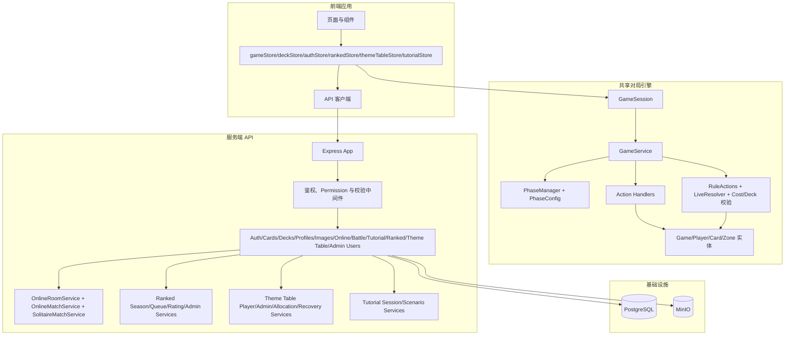
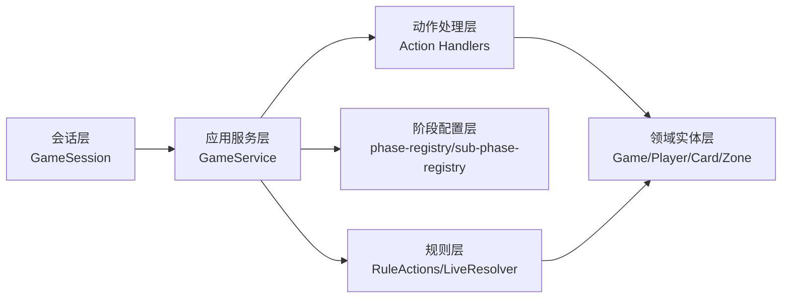
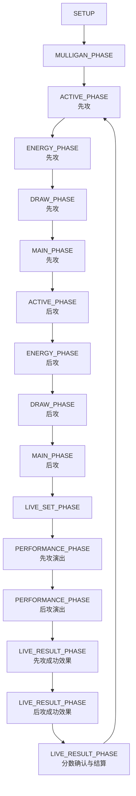
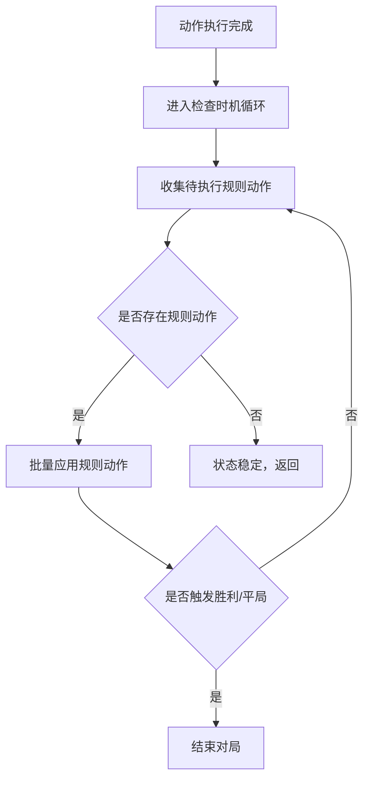
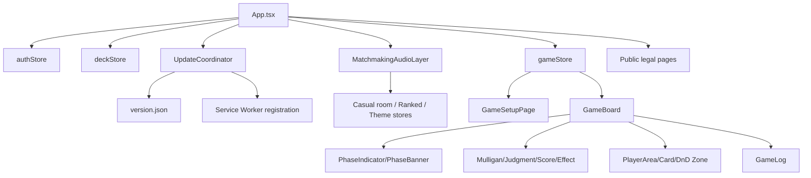
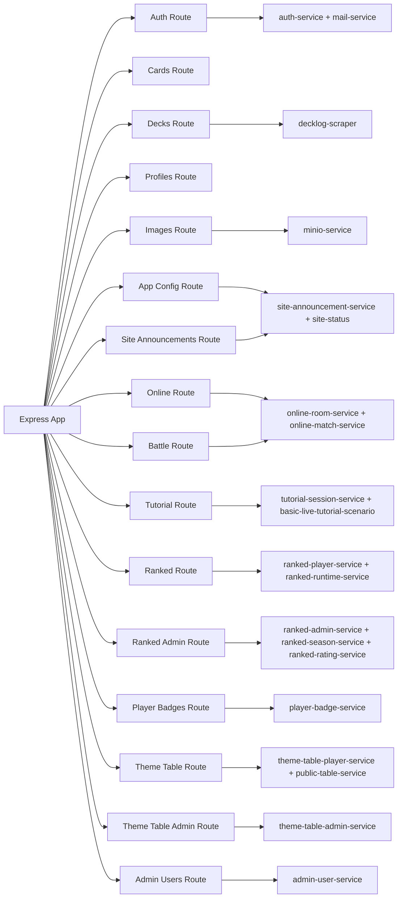
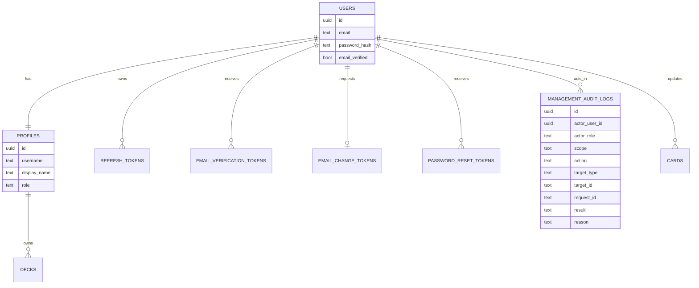
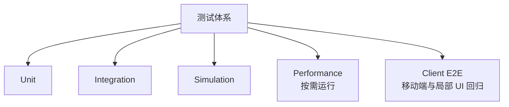

# Loveca 游戏系统设计文档

> 文档类型：设计文档  
> 适用范围：Loveca 当前代码架构与关键流程设计（基于现状实现）  
> 当前状态：现行系统设计；字段级 schema 以 `src/server/db/schema.ts` 和 `drizzle/` 增量迁移为准，初始化函数与触发器以 `docker/init.sql` 为准
> 最后更新：2026-10-23

---

## 1. 设计目标与范围

本文回答当前系统如何实现产品要求。产品目标见[总体需求](PROJECT_REQUIREMENTS.md)，能力覆盖见[项目现状](current-state.md)，工作排序见[项目待办](../PROJECT_PROGRESS_TODO.md)；各文档职责以[文档地图](README.md#总领文档的职责)为准。

重点覆盖：

- 对局引擎分层与状态机设计
- 规则处理与动作执行链路
- 前后端边界与数据流
- 持久化与资源服务设计
- 已实现功能对应的代码路径

运行时数据结构、算法链路、卡效/LIVE/recorder 热路径和跨模块不变量的横向说明，见 [运行时数据结构与算法链路](runtime-data-flow-and-algorithm-chain.md)。本文档维护系统全景和模块职责，不重复维护逐条运行时链路。

不包含内容：

- 具体实现代码
- 逐行算法说明
- 逐条运行时数据结构关系和热路径分析
- 历史旧版 OOP 伪模型

---

## 2. 总体架构设计

设计原则：

- 对局规则与 UI 展示解耦
- 阶段规则配置化，减少硬编码
- 动作处理器按职责拆分，便于扩展
- 本地离线可运行，在线能力通过 API 增强

---

## 3. 对局引擎分层设计

### 3.1 会话层

职责：

- 维护权威状态
- 接收并派发玩家动作
- 处理自动推进与规则自动化策略差异（`GameMode.DEBUG` / `GameMode.SOLITAIRE`）；正式联机由服务端房间/对局服务持有会话并通过座位映射驱动同一个 `GameSession`
- 提供玩家视角状态读取接口；联机快照通过 `PlayerViewState` 投影输出，不直接暴露权威状态

代码路径：

- `src/application/game-session.ts`
- `src/online/projector.ts`
- `src/online/visibility.ts`

### 3.2 应用服务层

职责：

- 初始化对局
- 统一动作执行与结果返回
- 驱动阶段流转
- 触发检查时机与规则处理

代码路径：

- `src/application/game-service.ts`

### 3.3 阶段配置层

职责：

- 统一定义主阶段行为、转换条件、自动动作
- 统一定义子阶段顺序与是否需要用户操作
- 提供活跃玩家判定策略

代码路径：

- `src/shared/phase-config/phase-registry.ts`
- `src/shared/phase-config/sub-phase-registry.ts`
- `src/shared/phase-config/active-player.ts`
- `src/application/phase-manager.ts`

### 3.4 动作处理层

职责：

- 按动作类型分发处理器
- 落地卡牌移动、子阶段确认、分数确认、撤销、应援等动作
- 统一动作成功/失败结果语义

代码路径：

- `src/application/action-handlers/index.ts`
- `src/application/action-handlers/play-member.handler.ts`
- `src/application/action-handlers/live-set.handler.ts`
- `src/application/action-handlers/mulligan.handler.ts`
- `src/application/action-handlers/tap-member.handler.ts`
- `src/application/action-handlers/phase-ten.handler.ts`
- `src/application/action-handlers/zone-operations.ts`
- `src/application/actions.ts`

### 3.5 规则层

职责：

- 处理规则动作（刷新、胜利检测、非法状态清理）
- 提供 Live/Heart 相关领域计算能力
- 提供费用与卡组校验能力

当前实现说明：

- 运行时主链路中的检查时机由 `GameService.executeCheckTiming()` 直接驱动 `rule-actions`
- `src/domain/rules/check-timing.ts` 保留了更完整的检查时机/自动能力处理模型，但当前未接入主流程
- `src/domain/rules/live-resolver.ts` 目前主要作为领域计算模块与测试覆盖对象，未作为对局主链路唯一入口

代码路径：

- `src/domain/rules/live-resolver.ts`
- `src/domain/rules/rule-actions.ts`
- `src/domain/rules/check-timing.ts`
- `src/domain/rules/cost-calculator.ts`
- `src/domain/rules/deck-validator.ts`
- `src/domain/value-objects/heart.ts`

### 3.6 领域实体层

职责：

- 承载对局状态结构与不可变更新语义
- 管理玩家、区域、卡牌实例与历史记录

代码路径：

- `src/domain/entities/game.ts`
- `src/domain/entities/player.ts`
- `src/domain/entities/zone.ts`
- `src/domain/entities/card.ts`

---

## 4. 对局流程状态机设计

子阶段设计原则：

- 主阶段下沉到可观察子阶段，支持 UI 精细控制
- 子阶段标注是否需要玩家确认
- 自动子阶段用于抽牌、推进与清理
- Live 成功效果在双方表演完成后依次处理，顺序为先攻成功效果、后攻成功效果，再进入分数确认与结算

代码路径：

- `src/shared/types/enums.ts`
- `src/shared/phase-config/sub-phase-registry.ts`

---

## 5. 动作执行链路设计

前端操作转换为 `GameCommand`，本地经 `GameSession.executeCommand()` 执行，远程经服务端鉴权、座位映射与命令队列进入同一会话入口。会话层组织规则动作、卡效与自动推进，`GameService` 和规则处理器维护权威状态。

界面读取 `PlayerViewState` 投影：本地由 `getPlayerViewState()` 生成，远程由快照返回。组件不接收完整权威状态再自行隐藏私密数据，也不绕过命令入口改状态。逐步时序、记录和增量事件路径统一见[运行时主命令链路](runtime-data-flow-and-algorithm-chain.md#3-主命令链路)。

代码路径：

- `client/src/store/gameStore.ts`
- `src/application/game-session.ts`
- `src/application/game-service.ts`
- `src/application/action-handlers/`

---

## 6. 规则校正与操作模式设计

设计说明：

- 新对局默认 `RULES`，玩家输入先经过中央命令政策，只允许当前阶段、pending 和卡效流程明确开放的语义化命令
- `FREE` 在安全时点显式开启，保留己方区域的兼容移动与人工规则处理；正式联机开启需要对方同意，任意一方可单方恢复 `RULES`
- 系统规则处理负责客观状态纠偏，但不以“先接受非法命令、再自动清理”替代命令入口校验
- 胜利检测由规则层统一处理
- 已登记卡效进入自动能力队列；未登记或未接线卡效需要人工处理时，应先进入 `FREE`

代码路径：

- `src/application/manual-operation-mode.ts`（权威模式读取、切换安全点与命令重写）
- `src/application/player-command-policy.ts`（`RULES` / `FREE` 中央玩家命令政策）
- `src/application/game-session.ts`（权威状态、命令校验与模式切换）
- `src/application/game-service.ts`
- `src/domain/rules/rule-actions.ts`
- `src/domain/rules/check-timing.ts`（当前为未接线的完整模型实现）
- `src/online/projector.ts`（玩家视图、权限与模式投影）
- `src/server/services/online-match-service.ts`（正式联机协商、席位校验与服务端权威执行）
- `src/server/services/replay-payload-serialization.ts`（历史 authority checkpoint 的窄复水兼容边界）

---

## 7. 前端架构设计

职责划分：

- `gameStore`：对局状态桥接与动作封装
- `deckStore`：卡组编辑、浏览器本地卡组持久化与云端卡组管理；云端列表按登录用户隔离当前会话快照，以 30 秒 freshness 区分 `ensureCloudDecks` 的按需读取和 `refreshCloudDecks` 的强制确认读取，同用户并发请求共享同一 Promise，后台刷新失败时继续保留旧快照
- `authStore`：认证、会话恢复、个人资料与凭据更新、离线模式
- `casualTableStore`：绑定登录用户的休闲房间准备与赛后状态桥接；唯一全局协调器负责读取、心跳和一次性进房，列表保留在大厅页面
- `rankedStore`：赛季总览与跨页面排位候场、确认和取消状态
- `themeTableStore`：主题活动总览与跨页面候场、确认、分配和开局前恢复状态
- `tutorialStore`：只在当前页面生命周期内持有教程访问令牌、玩家投影和公开命令回执，并通过 `remoteMatchClient` 把教程会话接入共享 `gameStore` 桌面；现有本地或远程对局占用会阻止教程接管牌桌
- `MatchmakingAudioLayer`：统一订阅休闲房间准备、赛季排位和娱乐模式候场状态；只在实际进入候场时通过 `client/src/lib/matchmakingBgmClient.ts` 刷新公共曲库，离开候场不会重复读取，并由 `MatchmakingAudioPlayer` 从用户当前有效子集随机循环一首等待音乐，形成配对后按预留或休闲轮次身份只播放一次独立提示音。`src/server/services/matchmaking-bgm-service.ts` 与 `src/server/routes/matchmaking-bgm.ts` 管理曲库、平台默认子集及内容寻址的公共 MP3；对象沿用 `/images/` 公共资源链路读取，`src/server/routes/images.ts` 同步提供受限开发 fallback。管理页支持多文件队列、逐项上传进度与失败项重试，队列在客户端逐个调用单文件上传接口；曲库卡片提供原生音频试听，平台默认子集独立保存。管理员上传在进入内存解析前按用户与来源地址限制尝试次数，解析后再限制窗口累计字节；服务层跳过合法 ID3v2 标签后要求至少两个连续且参数一致的 MPEG 音频帧，不再只按文件头接受内容。`profiles.matchmaking_bgm_track_ids` 为 `NULL` 时实时跟随平台默认值，非空数组保存用户自选集合，空数组表示候场静音；播放时始终与当前曲库取交集。音频在用户加入候场的操作中主动启动，以满足浏览器播放授权；自动播放、曲库读取或音频加载失败都不改变候场、确认或进房状态。账户中心继续分别保存候场背景音乐与匹配成功提示音开关，`authStore` 的当前 profile 将开关和曲目偏好注入该层
- `UpdateCoordinator`：在应用渲染后统一接收 `version.json` 与 prompt 型 Service Worker 的更新信号；版本发现只产生非阻断提示，进行中的本地/远程对局不提供更新入口，玩家在安全页面确认后才激活 waiting worker 并执行单次刷新。版本发现与安装就绪分别展示；确认后最多等待 3 分钟完成下载/安装，再发送 `SKIP_WAITING`，最多等待 60 秒确认 worker 接管后刷新。注册失败可重试，超时或失败恢复重试入口，后台检查不会清除同一版本的错误；超时后到达的完成事件不自动刷新。原生注册、安装与控制权事件由 `appUpdateRegistration` 统一管理，PWA 插件不额外注入注册脚本。激活与刷新前重新检查对局状态，避免等待期间进入对局后被刷新
- 公开法律页：`App.tsx` 在认证与卡牌数据门禁之外识别 `/legal/disclaimer`、`/legal/takedown` 和 `/legal/privacy`；法律页作为应用壳的同步模块直接可用，普通同窗口链接通过 History API 切换并保留前进/后退，直达 URL 与修饰键/新标签页继续使用原生链接语义；法律声明和入口只由公开首页与登录后的大厅首页渲染，`ProductFrame` 不默认注入，运营管理、赛季、排位、观战、历史、法律文件及其他内页均不显示该页脚
- `GameBoard`：拖拽与对局主交互容器
- `TutorialPage` / `TutorialBattleSurface`：组合共享牌桌、公开步骤控制器和独立聚焦层；聚焦层只读取稳定语义锚点与当前玩家可见对象，不直接提交或模拟规则结果

代码路径：

- `client/src/store/gameStore.ts`
- `client/src/store/deckStore.ts`
- `client/src/store/authStore.ts`
- `client/src/store/rankedStore.ts`
- `client/src/store/themeTableStore.ts`
- `client/src/store/tutorialStore.ts`
- `client/src/lib/matchmakingAudio.ts`
- `client/src/components/matchmaking/MatchmakingAudioLayer.tsx`
- `client/src/lib/appUpdateCoordinator.ts`
- `client/src/lib/appUpdateRegistration.ts`
- `client/src/lib/legalPages.ts`
- `client/src/components/common/AppUpdateNotice.tsx`
- `client/src/components/common/LegalNotice.tsx`
- `client/src/components/pages/LegalPage.tsx`
- `client/src/components/pages/ThemeTablePage.tsx`
- `client/src/components/pages/TutorialPage.tsx`
- `client/src/components/tutorial/`
- `client/src/lib/tutorialScenario.ts`
- `client/src/components/theme-table/ThemeTableGlobalLayer.tsx`
- `client/src/components/pages/AccountCenterPage.tsx`
- `client/src/components/game/`
- `client/src/components/pages/GameSetupPage.tsx`

---

## 8. 服务端与数据设计

### 8.1 API 模块设计

代码路径：

- `src/server/app.ts`
- `src/server/routes/auth.ts`
- `src/server/routes/cards.ts`
- `src/server/routes/decks.ts`
- `src/server/routes/profiles.ts`
- `src/server/routes/images.ts`
- `src/server/routes/app-config.ts`
- `src/server/routes/match-emotes.ts`
- `src/server/routes/ai-effect-extraction.ts`
- `src/server/routes/site-announcements.ts`
- `src/server/routes/online.ts`
- `src/server/routes/battle.ts`
- `src/server/routes/tutorial.ts`
- `src/server/routes/ranked.ts`
- `src/server/routes/ranked-admin.ts`
- `src/server/routes/player-badges.ts`
- `src/server/routes/theme-table.ts`
- `src/server/routes/theme-table-admin.ts`
- `src/server/routes/admin-users.ts`
- `src/server/routes/platform-operations.ts`
- `src/server/site-status.ts`
- `src/server/services/site-announcement-service.ts`
- `src/server/services/admin-user-service.ts`
- `src/server/services/platform-operations-service.ts`
- `src/server/services/replay-retention.ts`
- `src/server/middleware/require-permission.ts`
- `src/server/middleware/require-gameplay-available.ts`
- `src/server/services/`
- `src/server/services/tutorial-session-service.ts`
- `src/server/services/basic-live-tutorial-scenario.ts`

认证与会话链路：

- 访问令牌固定使用带 issuer、audience、subject 与角色约束的 HS256 JWT；浏览器只在内存中保存访问令牌。
- 账号角色固定为 `user / season_admin / admin`，共享 permission 允许列表位于 `src/shared/auth/permissions.ts`。排位、主题赛季和赛季入口使用各自的赛季权限；平台、卡牌、构筑规则和用户管理使用独立权限，只有平台管理员拥有完整集合。
- 特权中间件先校验令牌角色，再读取 `profiles.role` 复核当前授权。角色不一致时返回稳定的 `AUTHORIZATION_STALE`，前端清除内存令牌并返回登录页；权限提升也必须通过新会话取得包含新角色的令牌。
- 刷新令牌通过 HttpOnly Cookie 传递，Cookie 保存令牌定位符与随机 secret，数据库只保存 secret 预哈希后的 bcrypt 摘要；刷新和当前设备登出分别在数据库事务中锁定、校验并轮换或撤销目标令牌。
- 平台管理员通过独立用户管理服务分页读取账号摘要，并在角色下拉菜单中直接修改角色。角色变更事务锁定平台管理员集合与目标账号，使用 `expectedRole` 防止并发覆盖，阻止最后一个平台管理员被降级，并在同一事务内撤销目标全部刷新令牌；角色修改不要求原因，也不写入持久审计。
- 启用 `EMAIL_ENABLED` 后，注册邮箱和登录前验证成为强制门禁，服务启动时校验完整 SMTP 配置。邮箱验证、密码重置与邮箱换绑只保存带密钥摘要；邮箱换绑先校验当前密码并向新邮箱发送一次性链接，确认时在同一事务中更新邮箱、撤销刷新令牌并清理其他认证 token。邮件链接通过 URL fragment 交给前端并在页面初始化时清理。
- 认证端点统一返回不可缓存响应，并使用按 IP 与账号标识组合的有界限流。认证和图片/BGM 上传限流均使用 API 进程内的内存桶，重启后清空，不跨实例共享；多实例部署前需提供共享限流或可信代理的等价限制。
- 修改或重置密码、确认邮箱换绑会撤销刷新令牌，但已签发访问令牌没有服务端黑名单，仍可使用到自然过期（默认 15 分钟）；特权请求继续执行当前角色复核。
- 客户端在支持 Web Locks 时跨标签页串行刷新令牌；不支持时只保证单标签页内的并发去重。边界由 `client/src/lib/apiClient.ts` 承担。
- 运行时只接受 v2 刷新 Cookie 和一次性 token 格式；维护窗口中的认证切换将可识别的旧 bcrypt 密码封装成显式兼容状态，成功登录后原子升级为当前 v2 预哈希格式。原始旧 Cookie 和一次性 token 统一失效；已标记重置或未知密码格式会阻断迁移，不以运行时兜底伪装为可登录账号。

密码兼容路径目前接受 `$loveca-bcrypt-raw$` 包装格式，登录成功后升级为 `$loveca-bcrypt-sha256$` 并撤销旧会话，不直接接受裸旧 bcrypt。这是与 `AGENTS.md` 禁止运行时懒迁移原则的已确认偏差，不构成新增兼容例外的依据；待修事项由 `PROJECT_PROGRESS_TODO.md` 跟踪，既有转换行为见 `drizzle/migration-notes/auth-v1-to-v2-credential-cutover.md`。

认证关键代码路径：

- `src/server/config.ts`
- `src/server/middleware/authenticate.ts`
- `src/server/middleware/require-permission.ts`
- `src/server/middleware/auth-rate-limit.ts`
- `src/server/routes/auth.ts`
- `src/server/routes/admin-users.ts`
- `src/server/services/auth-service.ts`
- `src/server/services/admin-user-service.ts`
- `src/shared/auth/permissions.ts`
- `src/server/services/mail-service.ts`
- `client/src/lib/apiClient.ts`
- `client/src/store/authStore.ts`
- `client/src/components/pages/AccountCenterPage.tsx`
- `drizzle/data-migrations/auth-v1-to-v2-credential-cutover.ts`

### 8.2 数据模型设计

字段级数据库定义不在本文档重复维护；当前代码侧 schema 见 `src/server/db/schema.ts`，物理变更顺序见 `drizzle/` 增量迁移，基础初始化结构和数据库函数/触发器见 `docker/init.sql`。新库必须先执行初始化脚本，再执行全部增量迁移。

赛季排位在公共牌桌的持久票据/预留状态机上增加独立 `RANKED` 队列上下文，并以赛季、
排位对局、追加式评分事件、物化步骤、当前积分投影和跨赛季种子组成可审计结算模型。
候场与配对按赛季冻结的竞技环境隔离；权威对局封存后由评分服务幂等结算，迟到结果或
管理员更正按稳定顺序重建派生投影。字段、事务和更正链细节见
[赛季排位数据与结算设计](matchmaking-and-ladder/RANKED_R2_DATA_AND_SETTLEMENT_DESIGN.md)。

玩家徽章以持久规则和幂等授予记录分离活动配置、资格来源与玩家所有权；排位结算和主题对局封存分别触发幂等授予，图片使用不可变对象引用。资格规则、补发、资源替换与迁移细节见[活动徽章说明](../drizzle/migration-notes/activity-badges.md)。

轮换主题牌桌复用持久票据与预留状态机，并使用独立 `THEME` 队列和活动环境身份。先匹配形成预留，再生成稳定预组候选；最终选择锁入现有票据快照，历史分配不随预组编辑而改变。主题对局记录胜负，不写入排位评分投影；开局前恢复由主题恢复服务处理。玩家流程、候选算法、卡组版本与运营验收边界由[主题牌桌需求与设计](matchmaking-and-ladder/ROTATING_THEME_TABLE_DESIGN.md)维护。

代码路径：

- `src/server/db/schema.ts`
- `src/server/db/drizzle.ts`
- `src/server/db/pool.ts`
- `src/server/services/ranked-season-service.ts`
- `src/server/services/ranked-player-service.ts`
- `src/server/services/ranked-rating-service.ts`
- `src/server/services/ranked-runtime-service.ts`
- `src/server/services/ranked-admin-service.ts`
- `src/server/services/ranked-v3-migration-service.ts`
- `src/server/services/player-badge-service.ts`
- `src/server/player-badges/award.ts`
- `src/server/services/theme-table-player-service.ts`
- `src/server/services/theme-table-admin-service.ts`
- `src/server/services/theme-table-allocation-service.ts`
- `src/server/services/theme-table-deck-choice.ts`
- `src/server/services/theme-table-recovery-service.ts`
- `src/server/rating/ranked-ledger.ts`
- `src/server/rating/glicko.ts`
- `scripts/migrate-ranked-season-v3.ts`
- `drizzle/0010_add_ranked_system.sql`
- `drizzle/0019_add_player_badges.sql`
- `drizzle/0026_add_theme_table_v1.sql`
- `drizzle/0036_add_theme_deck_choice.sql`

---

## 9. 测试设计与覆盖结构

代码路径：

- 单元与集成：`tests/unit/`、`tests/integration/`
- 流程仿真：`tests/simulation/`
- 性能基准：`tests/performance/`
- 前端 E2E：`client/tests/e2e/`，覆盖移动端、响应式布局、局部 UI 回归，以及排位玩家/管理员真实 API 流程；`client/test-results/` 或根目录 `test-results/` 仅为运行产物，不作为测试入口

---

## 10. 专题模块与实现入口

本章用于从系统架构定位专题模块，具体参数、交互契约及验收条件由所链接的专题维护。阶段计划、部署记录与产品完成状态分别在计划专题、Runbook 和项目现状页维护。

| 模块 | 架构职责与关键入口 | 专题 |
| --- | --- | --- |
| AI 对战 | `src/server/services/ai-battle-service.ts` 管理会话，`src/server/ai-battle/` 负责可见输入与模型驱动；命令仍提交到共享 MatchService 队列。 | [运行与观测](ai-battle/runtime-and-observation.md) |
| 新手教程 | `src/server/services/tutorial-session-service.ts` 持有临时权威会话；客户端独立引导层组合共享牌桌，只读取公开步骤与可见对象。 | [教程需求](tutorial/requirements.md)、[模型对应关系](tutorial/match-model-correspondence.md) |
| 对局入口与练习 | `client/src/components/pages/HomePage.tsx` 提供玩法入口，`CasualLobbyPage.tsx` 承担休闲流程，`GameSetupPage.tsx` 仅负责对墙打／双人调试选组与确认；本地视角由 `client/src/lib/debugPerspective.ts` 协调。 | [模式说明](battle-mode-purpose-and-boundaries.md)、[大厅设计](online-mode/community-lobby-design.md) |
| PT 与卡组准入 | `src/server/services/deck-point-table-service.ts` 管理发布身份及事务，客户端展示与服务端准入分别使用各自的可信边界。 | [卡组设计](deck-management/design.md) |
| 平台状态 | `src/server/site-status.ts` 定义三态；`site-announcement-service.ts` 协调数据库与独立公开快照，`readiness-service.ts` 验证恢复依赖，准入中间件执行新对局门禁。 | [维护与公告](platform-operations/site-status-and-announcements.md) |
| 休闲房间 | `src/server/services/casual-table-service.ts` 与 `casual-table-repository.ts` 持久管理准入和准备，绑定后沿用 OnlineRoomService／MatchService；`CasualTableGlobalLayer` 协调跨页面状态。 | [大厅设计](online-mode/community-lobby-design.md)、[生命周期](online-mode/room-exit-and-recovery.md) |
| 局内通信 | `src/server/services/online-match-chat-runtime.ts` 持有单局有界消息；`match-emote-catalog-service.ts` 管理目录与资源。消息不进入规则状态或回放。 | [文字与快捷表情](online-mode/match-emote-requirements-design.md) |
| 赛季与主题 | 排位的生命周期、评分和查询各归对应 service；主题由 Player／Admin／Allocation／Recovery services 承担活动准入与分配，开局后复用正式对局服务。入口为 `src/server/routes/ranked.ts` 与 `src/server/routes/theme-table.ts`。 | [排位架构](matchmaking-and-ladder/RANKED_R2_DATA_AND_SETTLEMENT_DESIGN.md)、[主题设计](matchmaking-and-ladder/ROTATING_THEME_TABLE_DESIGN.md) |
| 卡组环境 | `src/server/services/ranked-deck-observation-service.ts` 保存长期事实，分类引擎、发布与 worker 生成版本化派生结果；展示不读取完整回放负载。 | [卡组分类与环境](matchmaking-and-ladder/RANKED_DECK_CLASSIFIER.md) |
| 壁纸与活动资源 | `src/server/services/player-wallpaper-service.ts` 管理私有展示偏好，`activity-cover-service.ts` 与 `activity-badge-service.ts` 管理公共活动资源；不进入权威对局状态。 | [壁纸](player-wallpaper/design.md)、[封面](matchmaking-and-ladder/SEASON_ACTIVITY_COVER_REQUIREMENTS_AND_DESIGN.md)、[徽章迁移](../drizzle/migration-notes/activity-badges.md) |
| 对墙打恢复 | `src/server/services/solitaire-match-service.ts` 创建可记录对局，`solitaire-runtime-recovery-service.ts` 从 authority checkpoint 恢复；正式联机运行态仍在进程内，不能复用该入口重建缺失对局。 | [模式说明](battle-mode-purpose-and-boundaries.md)、[房间恢复](online-mode/room-exit-and-recovery.md) |
| 记录、回放与清理 | `src/server/services/match-recorder-service.ts` 写入记录，`match-replay-read-service.ts` 返回授权视角投影，`replay-retention.ts` 处理清理边界；`platform-operations-service.ts` 提供管理操作入口。 | [回放设计](match-replay/design.md)、[序列化契约](match-replay/serialization-contract.md) |

---

## 11. 文档维护约定

- 本文档维护当前架构与代码入口；规划中的模块只在对应专题明确标为计划，不加入当前结构充数
- 本文档维护系统全景、分层职责、状态机和模块入口；运行时数据结构关系、命令/卡效/LIVE/recorder 链路和跨模块不变量维护在 `docs/runtime-data-flow-and-algorithm-chain.md`
- 架构和流程图统一使用 Mermaid
- 产品目标变更更新需求，架构或模块职责变化更新本文；具体能力与任务状态分别维护在项目现状和项目待办
- 与外部系统强耦合时，需在相关模块文档中补充原始链接
